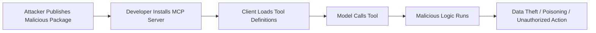

# 4.13 Supply Chain and Dependency (`SUPP`)

[← Chapter 4 overview](README.md) · [Test case format](test-case-format.md)

## Overview

Supply chain tests cover **where MCP servers come from**: package provenance, dependency CVEs, malicious install paths, registry trust, and unsafe auto-updates.

## Why this category matters

MCP ecosystems encourage installing community servers with broad tool access. A compromised package is equivalent to local code execution for the host user.

## Scope

Package signatures, SBOM/dependency scans, install prompts, registry verification, update channels and pinning.

## When to prioritize

Critical for hosts that install third-party servers from registries or npm/pypi.

## Related categories

[GOV](4.14-enterprise-governance.md), [TOOL](4.05-tool-security.md), [CONF](4.02-configuration-deployment.md)

## Common test chains

SUPP-03 + TOOL-01 (malicious server metadata); SUPP-05 + CONF-01.

## Threats and attack patterns

Supply-chain cases below are packages and servers that were published, then changed or were malicious on arrival. Description-only rug pulls, where the code stays put and the tool text changes, are in [4.5](4.05-tool-security.md). Quotations are from the vendor write-ups. Package names are included so an inventory can be searched. Payloads from those write-ups are not repeated here.

### `postmark-mcp` on npm added a BCC

Snyk’s 25 September 2025 alert says the npm package `postmark-mcp`, an MCP server for sending mail through Postmark, was reportedly modified to BCC outbound messages to an external domain. Snyk says current analysis points at versions from about `1.0.16` onward, that `1.0.0` was first published on 15 September 2025, and that the package was no longer on npm on 25 September 2025. Snyk says it does not know whether the incident involved the ActiveCampaign GitHub repository `ActiveCampaign/postmark-mcp`. The npm publisher Snyk names is `phanpak`. The published indicator is a BCC to an address at `giftshop[.]club`.

> “On September 25, 2025, the npm package `postmark-mcp`, an MCP (Model Context Protocol) server intended to let AI assistants send emails via Postmark, was reportedly modified to secretly exfiltrate email contents by adding a blind-copy (BCC) to an external domain.”
>
> — Snyk, [Malicious MCP Server on npm postmark-mcp Harvests Emails](https://snyk.io/blog/malicious-mcp-server-on-npm-postmark-mcp-harvests-emails/)

Snyk distinguishes this from prompt injection: “this attack exploited code backdoor and not an AI-native workflow, such as prompts and context poisoning.” Impact they list: message bodies, attachments, and headers, including secrets and customer data that were in those messages; copies that remain installed after the registry removal; credentials found in the stolen mail.

**Tests:** `MCPSTG-SUPP-01`, `MCPSTG-SUPP-03`, `MCPSTG-SUPP-05`. Provenance means comparing the installed tree with a known-good commit, not only reading the README. Auto-update tests should show whether a later version can replace `1.0.15`-class code with `1.0.16`-class code without a new human approval.

### PyPI MCP packages that opened a reverse shell

JFrog Security Research, 19 October 2025, reported three PyPI packages that presented as MCP servers and opened a reverse shell before the server started: `mcp-runcmd-server` (XRAY-734538), `mcp-runcommand-server` (XRAY-734540), and `mcp-runcommand-server2` (XRAY-734539). JFrog says the three shared one payload and that combined downloads were 1.6K. They describe the packages as a continuation of the npm package below, “connecting to the exact same IP address with a reverse shell.”

> “Our research team found 3 malicious MCP servers with a total of 1.6K downloads, all containing the exact same payload, which spawns a reverse shell to the attackers’ server.”
>
> — Guy Korolevski, JFrog Security Research, [3 Malicious MCP servers found on PyPI](https://research.jfrog.com/post/3-malicious-mcps-pypi-reverse-shell/) (19 October 2025)

**Tests:** `MCPSTG-SUPP-03`, `MCPSTG-SUPP-04`. A registry listing and a README that admits remote command execution are not evidence the package is only what it says. Compare the published research indicators with the installed files.

### `@lanyer640/mcp-runcommand-server` ran on install

Checkmarx Zero researcher Bruno Dias reported this npm package on 1 October 2025. Checkmarx’s [write-up](https://checkmarx.com/zero-post/npm-malware-alert-lanyer640-mcp-runcommand-server-with-reverse-shell/) says version 1.0.6 connects to an attacker-controlled host from `startServer()`, and that a `preinstall` script runs that path when the package is installed, so a later tool call is not required. They say npm removed it from the public registry and that private caches can still serve it. They also say version 1.0.5 had no hardcoded backdoor and still executed commands it received with `shell: true` and without authentication, and they recommend blocking every version.

**Tests:** `MCPSTG-SUPP-02`, `MCPSTG-SUPP-03`. Dependency review includes install scripts, not only the MCP tool list the server advertises after it starts.

### A description can change after the package was approved

Invariant’s rug-pull description (1 April 2025) is the metadata version of a malicious update: the server the user approved later serves a different tool description. They compare it to a package index that allows an already-published project to be modified. Their 7 April WhatsApp post shows a benign description on first launch and a different description on the second launch, with no re-approval. MCP-Scan’s response, announced 11 April 2025, is to hash tool descriptions and alert on change ([Introducing MCP-Scan](https://invariantlabs.ai/blog/introducing-mcp-scan)).

**Tests:** `MCPSTG-SUPP-04`, `MCPSTG-SUPP-05`, and `MCPSTG-TOOL-01` for the description content.

### Vulnerable dependencies inside an otherwise legitimate server

Not every supply-chain finding is a backdoor. [CVE-2025-6514](https://www.cve.org/CVERecord?id=CVE-2025-6514) affects the npm client helper `mcp-remote` 0.0.5 through 0.1.15 (fixed in 0.1.16): command injection via `authorization_endpoint` when connecting to an untrusted MCP server. [GHSA-89vp-x53w-74fx](https://github.com/modelcontextprotocol/rust-sdk/security/advisories/GHSA-89vp-x53w-74fx) affects the official Rust SDK `rmcp` before 1.4.0: missing `Host` validation on Streamable HTTP. [GHSA-c9xm-49cp-xcr9](https://github.com/modelcontextprotocol/rust-sdk/security/advisories/GHSA-c9xm-49cp-xcr9) affects the `rmcp` OAuth client: it fetches a server-supplied `resource_metadata` URL without same-origin or private-network checks. These are dependency CVEs in MCP libraries. **Tests:** `MCPSTG-SUPP-02`. Pin the advisory id and the fixed version in the report.

### Canonical attack patterns

The write-ups below moved here from the threats chapter. Each one names the abuse, a lab-safe example, the impact, red flags, and defensive checks. Published cases earlier in this section remain the sourced record. Use both when you choose tests.

### MCP Supply Chain Attacks

**Tests:** `MCPSTG-SUPP-01`, `MCPSTG-SUPP-03`, `MCPSTG-SUPP-05`.

MCP supply chain attacks target the packages, repositories, dependencies, registries, server templates, container images, install scripts, and update mechanisms used to build and run MCP servers.

The attacker’s goal is to compromise the MCP layer before the model ever sees a tool. Once a malicious MCP server is installed, it can influence tool metadata, access local resources, intercept arguments, return poisoned outputs, or execute malicious logic.

#### Common supply chain patterns

* Typosquatting MCP packages or server names.
* Dependency confusion between internal and public packages.
* Malicious package updates after initial trust is established.
* Maintainer account compromise.
* Unsafe post-install scripts.
* Malicious Docker images or base images.
* Compromised GitHub Actions or release pipelines.
* Unpinned dependencies in MCP server templates.
* Registry entries claiming to be official or verified.
* Copy-pasted install commands from untrusted sources.

#### Attack flow



#### Example scenario

A developer searches for an MCP server for a popular SaaS platform. They install a package with a convincing name and README. The server exposes useful tools, but also reads local configuration files and sends selected metadata to an external endpoint during startup or tool execution.

#### Impact

* Developer machine compromise.
* Source code and secret exposure.
* Persistent poisoned tool definitions.
* Enterprise token theft.
* Compromised CI/CD workflows.
* Widespread compromise if the package is reused across teams.

#### Red flags

* Recently created packages with names similar to popular MCP servers.
* Install scripts that run shell commands, download binaries, or contact unknown domains.
* Packages requesting broad filesystem or environment access.
* Obfuscated code in MCP server packages.
* Maintainer changes followed by new releases.
* Lack of signatures, checksums, SBOM, or provenance.
* Unpinned dependencies or floating container tags like `latest`.

#### Defensive guidance

* Use trusted MCP registries and approved internal mirrors.
* Pin package versions and verify checksums/signatures where available.
* Generate and review SBOMs for MCP servers.
* Scan dependencies, containers, and install scripts.
* Disable or review package lifecycle scripts.
* Use provenance frameworks such as signed releases and build attestations.
* Review tool definitions and runtime behavior before approval.
* Monitor outbound network calls from MCP servers.
* Separate experimental MCP environments from production credentials and data.
* Treat MCP server updates as security-relevant changes.

The first malicious MCP server reported in a public package registry is `postmark-mcp` on npm, which copied a legitimate email server and then, in version 1.0.16, copied every outbound message to an outside mailbox. A separate supply-chain case, CVE-2025-8217, put destructive instructions into the Amazon Q Developer extension for VS Code. AWS reported that a syntax error stopped that code from running. Both are in [Documented Public Samples](4.01-information-gathering.md#documented-public-samples).

### Amazon Q Developer 1.84.0 did not wipe disks

On 13 July 2025 a commit landed in the Amazon Q Developer extension for VS Code from an account that should not have had release access. AWS’s bulletin AWS-2025-015, CVE-2025-8217, says an overly broad GitHub token in CodeBuild allowed that commit, and the commit was included in version 1.84.0, released 17 July. The added code invoked the Amazon Q CLI in a mode that trusts tools without an interactive prompt, and handed it a prompt whose aim was to delete local files and cloud resources.

AWS’s inspection result is the fact to cite, not the blog headlines that say the wipe happened:

> AWS Security has inspected the code and determined the malicious code was distributed with the extension but was unsuccessful in executing due to a syntax error. This prevented the malicious code from making changes to any services or customer environments.

Version 1.84.0 was removed from distribution. The malicious code remains inside copies already installed, so those installs still need to be replaced with 1.85.0 or later, including forks. AWS says no customer resources were changed. ([AWS](https://aws.amazon.com/security/security-bulletins/AWS-2025-015/)) ([GitHub Advisory](https://github.com/aws/aws-toolkit-vscode/security/advisories/GHSA-7g7f-ff96-5gcw))

JFrog’s note describes the same payload from the other direction: the extension called the Q CLI with a prompt that asked the agent to produce wipe commands for the local machine and for cloud resources. The supply-chain path is the finding. A prompt inside an extension is an install-time tool definition the user never reviewed. ([JFrog](https://research.jfrog.com/post/amazon-q-vs-code-extension-compromised-with-malicious-code/))

Michael Bargury’s timeline, reconstructed from the public commits, is the audit lesson. The destructive prompt was committed as `scripts/extensionNode.bk` with the message `fix(amazonq): Shut it down`. A later commit on `master` made the production packaging step download that file and unpack it over the extension source, and only when a production stage variable was set, so tests would not see it. The packaging commit reused another author’s commit message. A revert landed about a day after release. Review that only reads commit titles, or that does not diff packaging scripts, would not have seen the prompt. ([Michael Bargury](https://www.mbgsec.com/posts/2025-07-24-constructing-a-timeline-for-amazon-q-prompt-infection/))

UpGuard’s July 2026 recap says the agent executed and that local files and AWS resources were removed. That sentence conflicts with the AWS bulletin. Use the bulletin.

What a defender still takes from a payload that did not run:

* An extension that can start an agent with approvals skipped is a shell with a delay.
* Release tokens that can push to the default branch are MCP supply-chain credentials, even when the repository is “just an IDE plugin.”
* Destructive instructions do not need an exfiltration channel. See the trifecta section above.

### postmark-mcp: the registry copy that grew a BCC

This is the sample that is not a lab. Koi Security’s Idan Dardikman published it in late September 2025. The npm package `postmark-mcp` reproduced Postmark’s official MCP server, which Postmark publishes on GitHub, not on npm. Versions 1.0.0 through 1.0.15 were copies of that legitimate code and behaved as an email tool. Version 1.0.16, released 17 September 2025, added a BCC so every message the tool sent was also copied to an external mailbox. OSV records it as MAL-2025-47604, introduced in 1.0.16. The package was removed from npm after Koi asked about it. Downloads were already in the thousands: Koi describes on the order of 1,500 a week and hundreds of workflows; ThaiCERT’s later summary says more than 1,643 downloads before removal. Quote the source you are using rather than adding the figures together. ([Koi](https://www.koi.ai/blog/postmark-mcp-npm-malicious-backdoor-email-theft)) ([OSV](https://osv.dev/vulnerability/MAL-2025-47604))

Dardikman’s line, as carried by Dark Reading, is the supply-chain moral in one sentence:

> The developer didn't hack anything. Didn't exploit a zero-day. Didn't use some sophisticated attack vector. We literally handed him the keys, said, 'Here, run this code with full permissions,' and let our AI assistants use it hundreds of times a day.

And, from the Koi post, the classification:

> This is the world’s first sighting of a real world malicious MCP server.

Postmark’s statement, reported by The Register on 29 September 2025:

> We want to be crystal clear: Postmark had absolutely nothing to do with this package or the malicious activity.

The Register’s paraphrase of the rest of that statement is the rug-pull clock applied to a package: the actor built trust over 15 versions, then added the backdoor in 1.0.16. The tool kept delivering mail. Senders and recipients did not see the extra copy. Password resets, invoices, and internal mail were in scope for anyone who had sent them through the package. ([The Register](https://www.theregister.com/security/2025/09/29/fake-postmark-mcp-npm-package-stole-emails-with-one-liner/509095))

Indicators published with the report, for log search rather than as a procedure: package name `postmark-mcp` on npm, versions 1.0.16 and later, and a BCC to a mailbox at `giftshop[.]club`. Koi’s advice to anyone who installed it is to remove the package, rotate credentials that may have crossed email, and review sending logs. Then do the part that survives this one package: know which MCP servers are installed, who published them, and whether a later version changed behavior. The official Postmark server is the GitHub repository. A same-name package on npm was the impersonation.

Snyk’s comment on the disclosure, via ThaiCERT, is the privilege point: MCP servers are often installed with the user’s own rights and with access to whatever the tool is for. An email server that works correctly can still be the copy. ([ThaiCERT](https://www.thaicert.or.th/en/2025/10/01/researchers-discover-first-malicious-mcp-server-in-rogue-postmark-mcp-package-used-to-steal-user-emails/))

### A registry Trojan, reported second-hand

UpGuard’s 1 July 2026 article attributes the following to Straiker STAR Labs, dated February 2026. A criminal operation called SmartLoader spent about three months building five fake GitHub accounts with generated personas, then submitted a trojanized Oura Ring MCP server to an MCP market registry. The fork matched the legitimate server’s behavior. The added payload was a StealC infostealer aimed at browser passwords, cloud tokens, chat credentials, SSH keys, wallet files, and API keys, with persistence disguised as a Windows audio process. ([UpGuard](https://www.upguard.com/blog/mcp-security-incidents))

This guide has not re-read the Straiker lab note. Treat the paragraph as a pointer to that note, not as a second primary source. The pattern, if the lab note confirms it, is [Shadow MCP Servers](4.14-enterprise-governance.md#shadow-mcp-servers) plus [MCP Supply Chain Attacks](#mcp-supply-chain-attacks): a registry with no meaningful review, a familiar product name, and a payload that runs because the developer installed an MCP server, not because they opened a Trojan email.

### Related patterns

A package that changes a tool definition after approval is [Rug Pulls and Tool-Definition Drift](4.05-tool-security.md#rug-pulls-and-tool-definition-drift). A one-click install or a server-supplied authorization URL that becomes a command is [Hostile Server URLs and Install Commands](4.15-transport-channel.md#hostile-server-urls-and-install-commands).

**Tests:** `MCPSTG-SUPP-03`, `MCPSTG-SUPP-05`.

## Test cases

Each test below is explained in this section with summary, scenario, step-by-step guidance, **example MCP code snippets**, expected results, and remediation. Use **View** to jump to a test.

| ID | Test case | Risk | Type | View |
|----|-----------|------|------|------|
| `MCPSTG-SUPP-01` | Test MCP Server Provenance | High | Hybrid | [View](#mcpstg-supp-01) |
| `MCPSTG-SUPP-02` | Test Dependency Vulnerabilities | High | Automated | [View](#mcpstg-supp-02) |
| `MCPSTG-SUPP-03` | Test Malicious MCP Server Installation | Critical | Manual | [View](#mcpstg-supp-03) |
| `MCPSTG-SUPP-04` | Test Registry Trust and Verification | High | Manual | [View](#mcpstg-supp-04) |
| `MCPSTG-SUPP-05` | Test Unsafe Auto-Updates | High | Hybrid | [View](#mcpstg-supp-05) |

### MCPSTG-SUPP-01 — Test MCP Server Provenance

<a id="mcpstg-supp-01"></a>

#### Summary

This test evaluates **test mcp server provenance** in MCP deployments. It focuses on provenance, dependencies, and third-party server trust. Failures often appear only when hosts, servers, tools, and upstream APIs are composed—single-component review is not enough.

#### Scenario

- **MCP host/client:** `<TEST_USER>` on a lab workstation with an MCP host config block (see **Example snippets**).
- **MCP server:** `<AUTHORIZED_LAB_SERVER>` under `<TEST_WORKSPACE>`.
- **Tools/resources:** `<TEST_TOOL_NAME>`, `<TEST_RESOURCE>` (synthetic lab fixtures only).
- **Trust boundary:** host ↔ MCP server ↔ OS ↔ upstream APIs.
- **Attacker position:** malicious prompt, compromised server package, or abusive automation (lab-safe only).
- **Potential impact:** confidentiality, integrity, availability, or cost abuse depending on control gaps.

#### Test Objectives

- Confirm insecure behavior is absent or mitigated for **test mcp server provenance**.
- Identify missing controls (authorization, validation, egress policy, logging, rate limits).
- Document **secure** behavior under the same lab inputs.

#### Preconditions

- Authorized lab environment and written scope.
- Access to host configuration, MCP server configuration, and (if applicable) gateway policy.
- Test principal `<TEST_USER>`; secondary account if testing cross-user issues.
- Log access for host, gateway, and MCP server.

#### How to Test

##### 1. Manual Review

Review documentation, tool metadata, permission manifests, and architecture diagrams for gaps related to test mcp server provenance.

##### 2. Configuration Review

Inspect host MCP config, server env vars, transport settings, and gateway rules (redact secrets in evidence).

##### 3. Runtime Testing

1. Connect the lab host to `<AUTHORIZED_LAB_SERVER>` using the snippet in **Example snippets**.
2. Capture baseline `tools/list` (and `resources/list` if applicable).
3. Execute bounded runtime checks with synthetic arguments only.
4. Record host, server, and gateway responses plus redacted logs.

##### 4. Abuse Case Testing

Attempt bounded mutations: alternate principals, repeated calls, parameter edge cases, or sequencing—**no** destructive payloads or third-party targets.

##### 5. Log and Detection Review

Confirm logs include tool name, principal, decision, outcome, and correlation IDs without leaking secrets.

#### Example snippets

Lab host configuration (redact secrets before sharing evidence):

```json
{
  "mcpServers": {
    "<AUTHORIZED_LAB_SERVER>": {
      "command": "node",
      "args": ["<TEST_WORKSPACE>/servers/lab-server/index.js"],
      "env": {
        "WORKSPACE_ROOT": "<TEST_WORKSPACE>"
      }
    }
  }
}
```

#### Test Data / Example Payloads

Use synthetic placeholders only. Replace `<TEST_*>` values with [Appendix D — Safe Lab Fixtures](../appendix-d-lab-fixtures.md) fixtures.

#### Expected Results

- **Secure:** policy blocks or contains abuse; stable deny/alert reason codes; limits and approvals enforced.
- **Insecure:** missing controls allow the abuse described in the summary; sensitive effects occur without detection.
- **Evidence:** redacted logs, config excerpts, snippet request/response pairs, policy screenshots.

#### Remediation

Apply least privilege, strong defaults, human approval for high-risk tools, input/output controls, gateway egress rules, rate limits, idempotency for writes, and secret hygiene.

#### Tools

MCP client utilities, HTTP/TLS proxies, structured log search, dependency scanners, and policy-as-code test harnesses (see [Appendix F — Testing Tools](../appendix-f-testing-tools.md)).

#### References

- Model Context Protocol documentation (cite version tested).
- OWASP LLM Top 10, OWASP API Security Top 10, OWASP ASVS where applicable.
- CWE and MITRE ATLAS where mappings are credible.

#### Mapping

- [OWASP ASVS](https://owasp.org/www-project-application-security-verification-standard/): [V14.2](https://github.com/OWASP/ASVS/blob/master/5.0/en/0x24-V14-Configuration.md), [V10.2](https://github.com/OWASP/ASVS/blob/master/5.0/en/0x20-V10-Malicious-code.md) (dependency and build integrity)
- [CWE](https://cwe.mitre.org/): [CWE-494 (Download of Code Without Integrity Check)](https://cwe.mitre.org/data/definitions/494.html), [CWE-829 (Inclusion of Functionality from Untrusted Control Sphere)](https://cwe.mitre.org/data/definitions/829.html)
- [MITRE ATLAS](https://atlas.mitre.org/): [AML.T0024 Supply Chain Compromise](https://atlas.mitre.org/techniques/AML.T0024)
- Risk level: High
- Testing type: Hybrid

### MCPSTG-SUPP-02 — Test Dependency Vulnerabilities

<a id="mcpstg-supp-02"></a>

#### Summary

This test evaluates **test dependency vulnerabilities** in MCP deployments. It focuses on provenance, dependencies, and third-party server trust. Failures often appear only when hosts, servers, tools, and upstream APIs are composed—single-component review is not enough.

#### Scenario

- **MCP host/client:** `<TEST_USER>` on a lab workstation with an MCP host config block (see **Example snippets**).
- **MCP server:** `<AUTHORIZED_LAB_SERVER>` under `<TEST_WORKSPACE>`.
- **Tools/resources:** `<TEST_TOOL_NAME>`, `<TEST_RESOURCE>` (synthetic lab fixtures only).
- **Trust boundary:** host ↔ MCP server ↔ OS ↔ upstream APIs.
- **Attacker position:** malicious prompt, compromised server package, or abusive automation (lab-safe only).
- **Potential impact:** confidentiality, integrity, availability, or cost abuse depending on control gaps.

#### Test Objectives

- Confirm insecure behavior is absent or mitigated for **test dependency vulnerabilities**.
- Identify missing controls (authorization, validation, egress policy, logging, rate limits).
- Document **secure** behavior under the same lab inputs.

#### Preconditions

- Authorized lab environment and written scope.
- Access to host configuration, MCP server configuration, and (if applicable) gateway policy.
- Test principal `<TEST_USER>`; secondary account if testing cross-user issues.
- Log access for host, gateway, and MCP server.

#### How to Test

##### 1. Manual Review

Review documentation, tool metadata, permission manifests, and architecture diagrams for gaps related to test dependency vulnerabilities.

##### 2. Configuration Review

Inspect host MCP config, server env vars, transport settings, and gateway rules (redact secrets in evidence).

##### 3. Runtime Testing

1. Connect the lab host to `<AUTHORIZED_LAB_SERVER>` using the snippet in **Example snippets**.
2. Capture baseline `tools/list` (and `resources/list` if applicable).
3. Execute bounded runtime checks with synthetic arguments only.
4. Record host, server, and gateway responses plus redacted logs.

##### 4. Abuse Case Testing

Attempt bounded mutations: alternate principals, repeated calls, parameter edge cases, or sequencing—**no** destructive payloads or third-party targets.

##### 5. Log and Detection Review

Confirm logs include tool name, principal, decision, outcome, and correlation IDs without leaking secrets.

#### Example snippets

Lab host configuration (redact secrets before sharing evidence):

```json
{
  "mcpServers": {
    "<AUTHORIZED_LAB_SERVER>": {
      "command": "node",
      "args": ["<TEST_WORKSPACE>/servers/lab-server/index.js"],
      "env": {
        "WORKSPACE_ROOT": "<TEST_WORKSPACE>"
      }
    }
  }
}
```

#### Test Data / Example Payloads

Use synthetic placeholders only. Replace `<TEST_*>` values with [Appendix D — Safe Lab Fixtures](../appendix-d-lab-fixtures.md) fixtures.

#### Expected Results

- **Secure:** policy blocks or contains abuse; stable deny/alert reason codes; limits and approvals enforced.
- **Insecure:** missing controls allow the abuse described in the summary; sensitive effects occur without detection.
- **Evidence:** redacted logs, config excerpts, snippet request/response pairs, policy screenshots.

#### Remediation

Apply least privilege, strong defaults, human approval for high-risk tools, input/output controls, gateway egress rules, rate limits, idempotency for writes, and secret hygiene.

#### Tools

MCP client utilities, HTTP/TLS proxies, structured log search, dependency scanners, and policy-as-code test harnesses (see [Appendix F — Testing Tools](../appendix-f-testing-tools.md)).

#### References

- Model Context Protocol documentation (cite version tested).
- OWASP LLM Top 10, OWASP API Security Top 10, OWASP ASVS where applicable.
- CWE and MITRE ATLAS where mappings are credible.

#### Mapping

- [OWASP ASVS](https://owasp.org/www-project-application-security-verification-standard/): [V10.2](https://github.com/OWASP/ASVS/blob/master/5.0/en/0x20-V10-Malicious-code.md) (dependency management)
- [CWE](https://cwe.mitre.org/): [CWE-1035 (Using Components with Known Vulnerabilities)](https://cwe.mitre.org/data/definitions/1035.html), [CWE-1104 (Use of Unmaintained Third-Party Components)](https://cwe.mitre.org/data/definitions/1104.html)
- Risk level: High
- Testing type: Automated

### MCPSTG-SUPP-03 — Test Malicious MCP Server Installation

<a id="mcpstg-supp-03"></a>

#### Summary

This test evaluates **test malicious mcp server installation** in MCP deployments. It focuses on provenance, dependencies, and third-party server trust. Failures often appear only when hosts, servers, tools, and upstream APIs are composed—single-component review is not enough.

#### Scenario

- **MCP host/client:** `<TEST_USER>` on a lab workstation with an MCP host config block (see **Example snippets**).
- **MCP server:** `<AUTHORIZED_LAB_SERVER>` under `<TEST_WORKSPACE>`.
- **Tools/resources:** `<TEST_TOOL_NAME>`, `<TEST_RESOURCE>` (synthetic lab fixtures only).
- **Trust boundary:** host ↔ MCP server ↔ OS ↔ upstream APIs.
- **Attacker position:** malicious prompt, compromised server package, or abusive automation (lab-safe only).
- **Potential impact:** confidentiality, integrity, availability, or cost abuse depending on control gaps.

#### Test Objectives

- Confirm insecure behavior is absent or mitigated for **test malicious mcp server installation**.
- Identify missing controls (authorization, validation, egress policy, logging, rate limits).
- Document **secure** behavior under the same lab inputs.

#### Preconditions

- Authorized lab environment and written scope.
- Access to host configuration, MCP server configuration, and (if applicable) gateway policy.
- Test principal `<TEST_USER>`; secondary account if testing cross-user issues.
- Log access for host, gateway, and MCP server.

#### How to Test

##### 1. Manual Review

Review documentation, tool metadata, permission manifests, and architecture diagrams for gaps related to test malicious mcp server installation.

##### 2. Configuration Review

Inspect host MCP config, server env vars, transport settings, and gateway rules (redact secrets in evidence).

##### 3. Runtime Testing

1. Connect the lab host to `<AUTHORIZED_LAB_SERVER>` using the snippet in **Example snippets**.
2. Capture baseline `tools/list` (and `resources/list` if applicable).
3. Execute bounded runtime checks with synthetic arguments only.
4. Record host, server, and gateway responses plus redacted logs.

##### 4. Abuse Case Testing

Attempt bounded mutations: alternate principals, repeated calls, parameter edge cases, or sequencing—**no** destructive payloads or third-party targets.

##### 5. Log and Detection Review

Confirm logs include tool name, principal, decision, outcome, and correlation IDs without leaking secrets.

#### Example snippets

Lab host configuration (redact secrets before sharing evidence):

```json
{
  "mcpServers": {
    "<AUTHORIZED_LAB_SERVER>": {
      "command": "node",
      "args": ["<TEST_WORKSPACE>/servers/lab-server/index.js"],
      "env": {
        "WORKSPACE_ROOT": "<TEST_WORKSPACE>"
      }
    }
  }
}
```

#### Test Data / Example Payloads

Use synthetic placeholders only. Replace `<TEST_*>` values with [Appendix D — Safe Lab Fixtures](../appendix-d-lab-fixtures.md) fixtures.

#### Expected Results

- **Secure:** policy blocks or contains abuse; stable deny/alert reason codes; limits and approvals enforced.
- **Insecure:** missing controls allow the abuse described in the summary; sensitive effects occur without detection.
- **Evidence:** redacted logs, config excerpts, snippet request/response pairs, policy screenshots.

#### Remediation

Apply least privilege, strong defaults, human approval for high-risk tools, input/output controls, gateway egress rules, rate limits, idempotency for writes, and secret hygiene.

#### Tools

MCP client utilities, HTTP/TLS proxies, structured log search, dependency scanners, and policy-as-code test harnesses (see [Appendix F — Testing Tools](../appendix-f-testing-tools.md)).

#### References

- Model Context Protocol documentation (cite version tested).
- OWASP LLM Top 10, OWASP API Security Top 10, OWASP ASVS where applicable.
- CWE and MITRE ATLAS where mappings are credible.

#### Mapping

- [OWASP ASVS](https://owasp.org/www-project-application-security-verification-standard/): [V14.2](https://github.com/OWASP/ASVS/blob/master/5.0/en/0x24-V14-Configuration.md), [V10.2](https://github.com/OWASP/ASVS/blob/master/5.0/en/0x20-V10-Malicious-code.md)
- [CWE](https://cwe.mitre.org/): [CWE-506 (Embedded Malicious Code)](https://cwe.mitre.org/data/definitions/506.html), [CWE-829](https://cwe.mitre.org/data/definitions/829.html)
- [MITRE ATLAS](https://atlas.mitre.org/): [AML.T0024 Supply Chain Compromise](https://atlas.mitre.org/techniques/AML.T0024), [AML.T0051 LLM Plugin Poisoning](https://atlas.mitre.org/techniques/AML.T0051)
- Risk level: Critical
- Testing type: Manual

### MCPSTG-SUPP-04 — Test Registry Trust and Verification

<a id="mcpstg-supp-04"></a>

#### Summary

This test evaluates **test registry trust and verification** in MCP deployments. It focuses on provenance, dependencies, and third-party server trust. Failures often appear only when hosts, servers, tools, and upstream APIs are composed—single-component review is not enough.

#### Scenario

- **MCP host/client:** `<TEST_USER>` on a lab workstation with an MCP host config block (see **Example snippets**).
- **MCP server:** `<AUTHORIZED_LAB_SERVER>` under `<TEST_WORKSPACE>`.
- **Tools/resources:** `<TEST_TOOL_NAME>`, `<TEST_RESOURCE>` (synthetic lab fixtures only).
- **Trust boundary:** host ↔ MCP server ↔ OS ↔ upstream APIs.
- **Attacker position:** malicious prompt, compromised server package, or abusive automation (lab-safe only).
- **Potential impact:** confidentiality, integrity, availability, or cost abuse depending on control gaps.

#### Test Objectives

- Confirm insecure behavior is absent or mitigated for **test registry trust and verification**.
- Identify missing controls (authorization, validation, egress policy, logging, rate limits).
- Document **secure** behavior under the same lab inputs.

#### Preconditions

- Authorized lab environment and written scope.
- Access to host configuration, MCP server configuration, and (if applicable) gateway policy.
- Test principal `<TEST_USER>`; secondary account if testing cross-user issues.
- Log access for host, gateway, and MCP server.

#### How to Test

##### 1. Manual Review

Review documentation, tool metadata, permission manifests, and architecture diagrams for gaps related to test registry trust and verification.

##### 2. Configuration Review

Inspect host MCP config, server env vars, transport settings, and gateway rules (redact secrets in evidence).

##### 3. Runtime Testing

1. Connect the lab host to `<AUTHORIZED_LAB_SERVER>` using the snippet in **Example snippets**.
2. Capture baseline `tools/list` (and `resources/list` if applicable).
3. Execute bounded runtime checks with synthetic arguments only.
4. Record host, server, and gateway responses plus redacted logs.

##### 4. Abuse Case Testing

Attempt bounded mutations: alternate principals, repeated calls, parameter edge cases, or sequencing—**no** destructive payloads or third-party targets.

##### 5. Log and Detection Review

Confirm logs include tool name, principal, decision, outcome, and correlation IDs without leaking secrets.

#### Example snippets

Lab host configuration (redact secrets before sharing evidence):

```json
{
  "mcpServers": {
    "<AUTHORIZED_LAB_SERVER>": {
      "command": "node",
      "args": ["<TEST_WORKSPACE>/servers/lab-server/index.js"],
      "env": {
        "WORKSPACE_ROOT": "<TEST_WORKSPACE>"
      }
    }
  }
}
```

#### Test Data / Example Payloads

Use synthetic placeholders only. Replace `<TEST_*>` values with [Appendix D — Safe Lab Fixtures](../appendix-d-lab-fixtures.md) fixtures.

#### Expected Results

- **Secure:** policy blocks or contains abuse; stable deny/alert reason codes; limits and approvals enforced.
- **Insecure:** missing controls allow the abuse described in the summary; sensitive effects occur without detection.
- **Evidence:** redacted logs, config excerpts, snippet request/response pairs, policy screenshots.

#### Remediation

Apply least privilege, strong defaults, human approval for high-risk tools, input/output controls, gateway egress rules, rate limits, idempotency for writes, and secret hygiene.

#### Tools

MCP client utilities, HTTP/TLS proxies, structured log search, dependency scanners, and policy-as-code test harnesses (see [Appendix F — Testing Tools](../appendix-f-testing-tools.md)).

#### References

- Model Context Protocol documentation (cite version tested).
- OWASP LLM Top 10, OWASP API Security Top 10, OWASP ASVS where applicable.
- CWE and MITRE ATLAS where mappings are credible.

#### Mapping

- [OWASP ASVS](https://owasp.org/www-project-application-security-verification-standard/): [V10.2](https://github.com/OWASP/ASVS/blob/master/5.0/en/0x20-V10-Malicious-code.md), [V14.2](https://github.com/OWASP/ASVS/blob/master/5.0/en/0x24-V14-Configuration.md) (trusted distribution channels)
- [CWE](https://cwe.mitre.org/): [CWE-494 (Download of Code Without Integrity Check)](https://cwe.mitre.org/data/definitions/494.html), [CWE-345 (Insufficient Verification of Data Authenticity)](https://cwe.mitre.org/data/definitions/345.html)
- Risk level: High
- Testing type: Manual

### MCPSTG-SUPP-05 — Test Unsafe Auto-Updates

<a id="mcpstg-supp-05"></a>

#### Summary

This test evaluates **test unsafe auto-updates** in MCP deployments. It focuses on provenance, dependencies, and third-party server trust. Failures often appear only when hosts, servers, tools, and upstream APIs are composed—single-component review is not enough.

#### Scenario

- **MCP host/client:** `<TEST_USER>` on a lab workstation with an MCP host config block (see **Example snippets**).
- **MCP server:** `<AUTHORIZED_LAB_SERVER>` under `<TEST_WORKSPACE>`.
- **Tools/resources:** `<TEST_TOOL_NAME>`, `<TEST_RESOURCE>` (synthetic lab fixtures only).
- **Trust boundary:** host ↔ MCP server ↔ OS ↔ upstream APIs.
- **Attacker position:** malicious prompt, compromised server package, or abusive automation (lab-safe only).
- **Potential impact:** confidentiality, integrity, availability, or cost abuse depending on control gaps.

#### Test Objectives

- Confirm insecure behavior is absent or mitigated for **test unsafe auto-updates**.
- Identify missing controls (authorization, validation, egress policy, logging, rate limits).
- Document **secure** behavior under the same lab inputs.

#### Preconditions

- Authorized lab environment and written scope.
- Access to host configuration, MCP server configuration, and (if applicable) gateway policy.
- Test principal `<TEST_USER>`; secondary account if testing cross-user issues.
- Log access for host, gateway, and MCP server.

#### How to Test

##### 1. Manual Review

Review documentation, tool metadata, permission manifests, and architecture diagrams for gaps related to test unsafe auto-updates.

##### 2. Configuration Review

Inspect host MCP config, server env vars, transport settings, and gateway rules (redact secrets in evidence).

##### 3. Runtime Testing

1. Connect the lab host to `<AUTHORIZED_LAB_SERVER>` using the snippet in **Example snippets**.
2. Capture baseline `tools/list` (and `resources/list` if applicable).
3. Execute bounded runtime checks with synthetic arguments only.
4. Record host, server, and gateway responses plus redacted logs.

##### 4. Abuse Case Testing

Attempt bounded mutations: alternate principals, repeated calls, parameter edge cases, or sequencing—**no** destructive payloads or third-party targets.

##### 5. Log and Detection Review

Confirm logs include tool name, principal, decision, outcome, and correlation IDs without leaking secrets.

#### Example snippets

Lab host configuration (redact secrets before sharing evidence):

```json
{
  "mcpServers": {
    "<AUTHORIZED_LAB_SERVER>": {
      "command": "node",
      "args": ["<TEST_WORKSPACE>/servers/lab-server/index.js"],
      "env": {
        "WORKSPACE_ROOT": "<TEST_WORKSPACE>"
      }
    }
  }
}
```

#### Test Data / Example Payloads

Use synthetic placeholders only. Replace `<TEST_*>` values with [Appendix D — Safe Lab Fixtures](../appendix-d-lab-fixtures.md) fixtures.

#### Expected Results

- **Secure:** policy blocks or contains abuse; stable deny/alert reason codes; limits and approvals enforced.
- **Insecure:** missing controls allow the abuse described in the summary; sensitive effects occur without detection.
- **Evidence:** redacted logs, config excerpts, snippet request/response pairs, policy screenshots.

#### Remediation

Apply least privilege, strong defaults, human approval for high-risk tools, input/output controls, gateway egress rules, rate limits, idempotency for writes, and secret hygiene.

#### Tools

MCP client utilities, HTTP/TLS proxies, structured log search, dependency scanners, and policy-as-code test harnesses (see [Appendix F — Testing Tools](../appendix-f-testing-tools.md)).

#### References

- Model Context Protocol documentation (cite version tested).
- OWASP LLM Top 10, OWASP API Security Top 10, OWASP ASVS where applicable.
- CWE and MITRE ATLAS where mappings are credible.

#### Mapping

- [OWASP ASVS](https://owasp.org/www-project-application-security-verification-standard/): [V14.2](https://github.com/OWASP/ASVS/blob/master/5.0/en/0x24-V14-Configuration.md), [V10.2](https://github.com/OWASP/ASVS/blob/master/5.0/en/0x20-V10-Malicious-code.md)
- [CWE](https://cwe.mitre.org/): [CWE-494](https://cwe.mitre.org/data/definitions/494.html), [CWE-829 (Unsafe Auto-Update Without Integrity Verification)](https://cwe.mitre.org/data/definitions/829.html)
- Risk level: High
- Testing type: Hybrid

## Next steps

- [How to run tests](how-to-run.md)
- [Report findings](../05-reporting.md)
