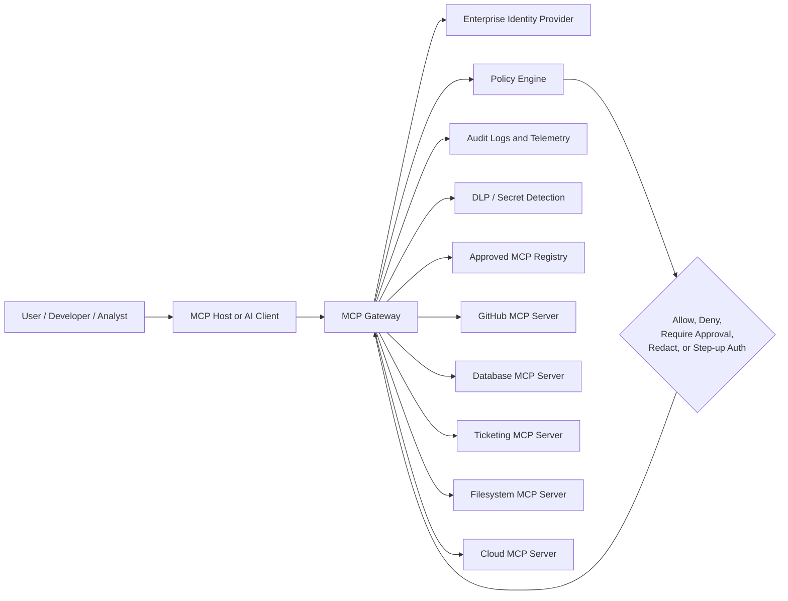
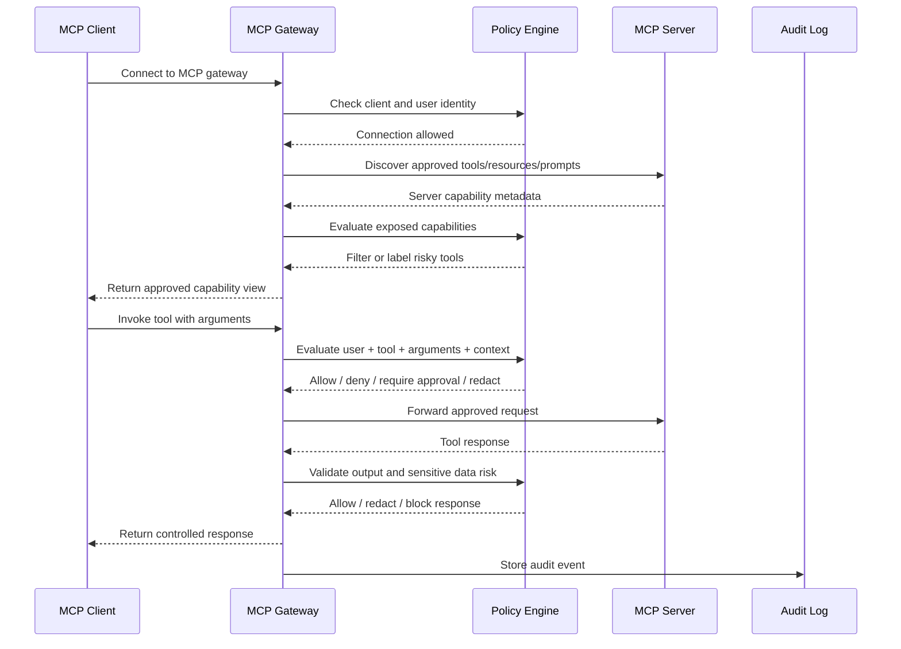
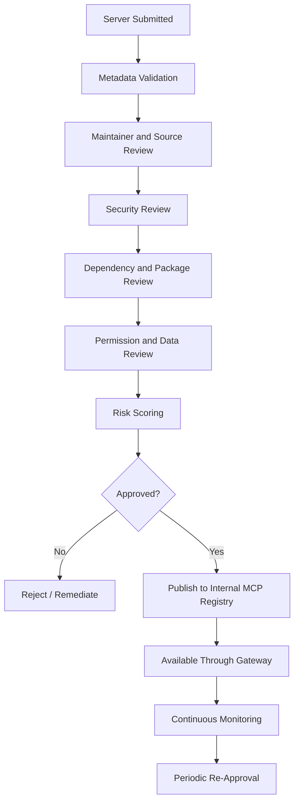
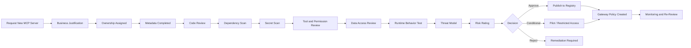
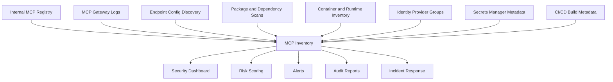
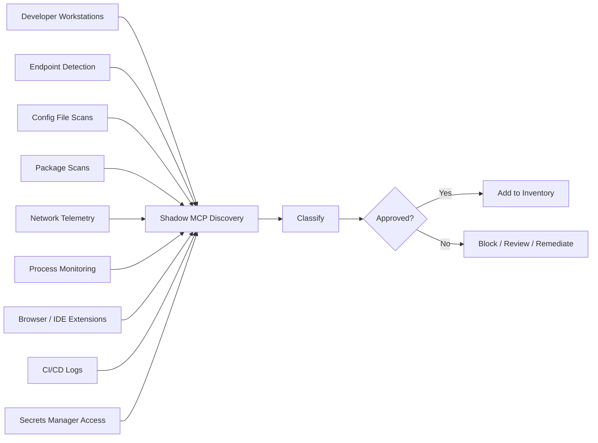

# 6. MCP Gateways, Registries, and Enterprise Governance

MCP adoption usually starts innocently: one developer connects an AI coding assistant to a local filesystem server, another team adds a GitHub server, a data team exposes a database connector, and suddenly the organization has AI systems that can read files, call APIs, update tickets, query production data, and trigger workflows.

That is the moment MCP stops being “just another integration” and becomes enterprise infrastructure.

This section explains how organizations can govern MCP at scale using gateways, registries, approval workflows, role-based access control, inventory management, and shadow MCP discovery. The goal is not to slow innovation down. The goal is to make MCP usable without turning every AI client into a tiny unsupervised intern with root access and excellent confidence.

Enterprise MCP governance should answer six practical questions:

1. **Which MCP servers are allowed?**
2. **Who approved them?**
3. **Which users, teams, agents, and clients can access them?**
4. **What tools, resources, prompts, and data do they expose?**
5. **What actions are being performed through them?**
6. **How do we detect unmanaged, risky, or malicious MCP usage?**

At enterprise scale, direct client-to-server connections are hard to govern. A gateway and registry model gives security, platform, and engineering teams a centralized control layer for routing, identity, policy, observability, approvals, and lifecycle management.

---

## 6.1 MCP Gateway Architecture

An MCP gateway is an infrastructure layer that sits between MCP clients and MCP servers. Instead of every AI client connecting directly to every approved or unapproved MCP server, the client connects to a controlled gateway. The gateway then routes requests to approved backend MCP servers based on identity, policy, tool scope, data sensitivity, and runtime context.

In simple terms: **an MCP gateway is the enterprise front door for MCP traffic.**

It can centralize:

* Authentication
* Authorization
* Routing
* Tool allowlisting and denylisting
* Policy enforcement
* Approval workflows
* Rate limiting
* Secrets handling
* Logging and monitoring
* Data loss prevention checks
* Server isolation
* Version control
* Emergency kill switches

Without a gateway, every MCP client becomes its own mini-control plane. That creates configuration sprawl, inconsistent permissions, weak auditability, and “who approved this thing?” moments during incidents.

### 6.1.1 Basic gateway pattern

```text
+-------------------+       +----------------------+       +-----------------------+
|                   |       |                      |       |                       |
|   MCP Client /    | ----> |     MCP Gateway      | ----> |   Approved MCP Server |
|   AI Host / IDE   |       |                      |       |   GitHub / DB / SaaS  |
|                   |       |  AuthN + AuthZ       |       |                       |
+-------------------+       |  Policy Enforcement |       +-----------------------+
                            |  Routing             |
                            |  Logging             |       +-----------------------+
                            |  DLP / Risk Scoring  | ----> |   Approved MCP Server |
                            |  Rate Limiting       |       |   Filesystem / Cloud  |
                            |  Approvals           |       +-----------------------+
                            |                      |
                            +----------------------+
```

### 6.1.2 Gateway architecture using Mermaid



### 6.1.3 What the gateway should enforce

A mature MCP gateway should not behave like a dumb reverse proxy. MCP traffic is not ordinary API traffic because the caller may be an AI agent acting on behalf of a user, a workflow, or another system. The gateway must understand enough about MCP usage to make security decisions at the level of **user + client + server + tool + action + data context**.

A strong gateway should enforce controls such as:

| Control Area       | What the Gateway Should Do                                                | Example                                                                          |
| ------------------ | ------------------------------------------------------------------------- | -------------------------------------------------------------------------------- |
| Authentication     | Verify the user, client, workload, or agent identity before access        | Only authenticated employees can use internal MCP servers                        |
| Authorization      | Check whether the identity can access a server, tool, resource, or action | Developers can read GitHub issues but cannot modify production deploy settings   |
| Tool Policy        | Allow, deny, or require approval for specific tools                       | `read_ticket` allowed, `delete_ticket` requires approval                         |
| Context Policy     | Evaluate what data is being sent to or returned from tools                | Block secrets, customer PII, or source code from being sent to untrusted servers |
| Routing            | Send traffic only to approved backend MCP servers                         | Route finance tools only through the finance-approved MCP server                 |
| Isolation          | Separate environments, tenants, teams, and trust zones                    | Sandbox experimental servers away from production resources                      |
| Monitoring         | Capture MCP calls, arguments, outputs, status, and decisions              | Log tool calls with user, client, server, tool, and policy outcome               |
| Rate Limiting      | Prevent runaway agents or abuse                                           | Stop an agent from calling `send_email` 500 times in 3 minutes                   |
| Change Control     | Detect server metadata and tool description changes                       | Alert when a tool description changes from read-only to write-capable behavior   |
| Emergency Response | Disable a server, tool, user, or client quickly                           | Kill switch for a compromised MCP server                                         |

### 6.1.4 Gateway policy decision points

A gateway should make decisions at multiple stages, not only at connection time.



### 6.1.5 Recommended gateway decision model

Every MCP request should be evaluated using a structured decision model:

```text
Decision = f(
  user_identity,
  client_identity,
  agent_identity,
  server_identity,
  tool_name,
  tool_version,
  requested_action,
  input_arguments,
  output_sensitivity,
  data_classification,
  environment,
  business_owner,
  risk_score,
  approval_state,
  session_context
)
```

This helps avoid overly broad decisions such as “Alice can use the GitHub MCP server.” A safer policy is: “Alice, from the approved coding client, can use read-only GitHub tools against repositories owned by her team, but write actions require approval and production branch changes are denied.”

### 6.1.6 Gateway trust zones

Enterprise MCP deployments should define trust zones for servers and clients.

| Trust Zone             | Description                                                                                                     | Example Controls                                                      |
| ---------------------- | --------------------------------------------------------------------------------------------------------------- | --------------------------------------------------------------------- |
| Public / Untrusted     | Community servers, experimental tools, unknown maintainers                                                      | Sandbox only, no secrets, no write tools, no sensitive data           |
| Internal Development   | Internal servers used by engineering teams                                                                      | SSO, team RBAC, source code access rules, logging                     |
| Production Operations  | Servers that can affect production systems                                                                      | Step-up auth, approvals, break-glass access, strong audit             |
| Regulated Data         | Servers accessing customer data, financial data, health data, or legal records                                  | DLP, data minimization, purpose limitation, encryption, strict review |
| High-Impact Automation | Servers that can send emails, approve workflows, change infrastructure, deploy code, or modify identity systems | Human-in-the-loop, transaction limits, separation of duties           |

### 6.1.7 Gateway security requirements

A production MCP gateway should support:

* **Strong identity integration** using enterprise SSO, workload identity, or service identity.
* **Per-tool authorization**, not only per-server authorization.
* **Per-action policy**, especially for write, delete, execute, deploy, transfer, or notify actions.
* **Capability filtering**, so clients only see tools they are allowed to use.
* **Tool risk labels**, such as read-only, write-capable, destructive, external-facing, sensitive-data, or privileged.
* **Argument inspection**, including file paths, URLs, repo names, command parameters, SQL queries, and ticket IDs.
* **Output inspection**, including secrets, credentials, tokens, PII, source code, internal URLs, and regulated data.
* **Session-aware authorization**, because an action may be safe in one context and unsafe in another.
* **Approval hooks**, where high-risk actions require user, manager, system owner, or security approval.
* **Immutable audit logs**, suitable for incident response, compliance, and forensic review.
* **Version and metadata tracking**, so changes to tool descriptions, schemas, dependencies, and permissions are visible.
* **Emergency disablement**, including disabling one tool without taking down an entire server.

### 6.1.8 Common gateway anti-patterns

Avoid these patterns:

* **Gateway as a blind pass-through**: If the gateway cannot inspect tool names, arguments, outputs, or server metadata, it provides limited MCP security value.
* **Server-level allowlisting only**: Approving an entire server without reviewing individual tools can expose dangerous actions.
* **One policy for all users**: Developers, SOC analysts, finance users, and executives should not inherit the same tool access.
* **No output validation**: Tool responses can contain prompt injection, secrets, poisoned context, or untrusted instructions.
* **No change detection**: A once-safe server can become unsafe after an update, dependency change, or maintainer compromise.
* **No user-visible approvals**: Users should understand when an AI system is about to perform a sensitive action on their behalf.
* **Long-lived shared credentials**: Shared tokens make attribution, revocation, and least privilege difficult.

### 6.1.9 Security outcome

A good gateway turns MCP from a collection of unmanaged point-to-point connections into a governed control plane. It gives organizations one place to enforce policy, one place to observe behavior, and one place to respond when something goes wrong.

### 6.1.10 Gateway and policy review

Record each row as Pass, Partial, Fail, Accepted Risk, or N/A. Status values and evidence fields are in [Appendix C — Security Review](<12. Appendix C - Security Review.md>).

| Check | What to verify | Why it matters | Evidence to collect | Good examples | Common gaps |
| --- | --- | --- | --- | --- | --- |
| Gateway need is assessed | Determine whether central brokering is needed. | Large organizations need consistent policy and visibility. | Architecture decision record. | Gateway used for sensitive tools and remote servers. | Every client connects directly to every server. |
| Gateway enforces identity | Gateway knows user, client, workspace, and server. | Policy needs context. | Auth design, token claims. | Policy uses user group and workspace trust. | Gateway only sees anonymous requests. |
| Gateway enforces authorization | Gateway can allow, deny, or require approval. | Central control reduces inconsistent client behavior. | Policy examples. | Block external-send tools for a low-privilege group. | Gateway is only a proxy with no policy. |
| Gateway logs decisions | Policy decisions must be auditable. | Helps SOC and compliance. | SIEM logs. | `decision=deny reason=external-destination`. | Only server-side logs exist. |
| Gateway supports emergency block | Security can rapidly block a server or tool. | Critical during incidents. | Admin runbook. | One-step block for a malicious server. | Must wait for every user to change config. |

Minimum acceptance criteria:

* High-risk MCP usage has centralized policy enforcement, logging, and emergency blocking.

---

## 6.2 MCP Registry Governance

An MCP registry helps users and clients discover MCP servers. In an enterprise, discovery is not only a convenience feature; it is a security boundary.

A registry answers:

* Which MCP servers exist?
* Who maintains them?
* Where is the source code?
* Which package or container provides the server?
* Which tools, resources, and prompts does it expose?
* Which permissions does it require?
* Which version is approved?
* Which business unit owns it?
* Which users and clients may connect to it?
* What is its risk score?

A public registry can help the ecosystem discover MCP servers. An enterprise registry should go further: it should function as an **approved catalog** of MCP servers that have passed security, legal, operational, and business review.

### 6.2.1 Registry governance model



### 6.2.2 Trusted registry principles

An enterprise MCP registry should be treated like an internal app store for AI-accessible capabilities.

Trusted registry governance should include:

* **Approved server lists** for production use.
* **Risk scores** for every server and tool.
* **Verified maintainers** for internal and external servers.
* **Known source locations**, such as GitHub repository, package registry, container image, or internal build system.
* **Provenance metadata**, including commit hash, package digest, container digest, build pipeline, and signer identity where available.
* **Security status**, including last scan, known vulnerabilities, dependency risk, and fix status.
* **Data classification**, including whether the server can access internal, confidential, regulated, customer, or production data.
* **Permission declarations**, including read, write, delete, execute, network, filesystem, database, identity, and deployment capabilities.
* **Change history**, including metadata drift, tool description changes, schema changes, and permission changes.
* **Owner accountability**, including technical owner, business owner, and security reviewer.

### 6.2.3 Suggested registry metadata fields

Each MCP server entry should include structured metadata.

| Field                    | Description                                              | Example                                  |
| ------------------------ | -------------------------------------------------------- | ---------------------------------------- |
| Server Name              | Canonical approved name                                  | `internal-github-mcp`                    |
| Display Name             | Human-readable name                                      | `GitHub MCP Server`                      |
| Unique Identifier        | Stable ID to avoid name confusion                        | `com.company.mcp.github`                 |
| Source Repository        | Where the code is maintained                             | Internal Git repository                  |
| Package Source           | npm, PyPI, container registry, binary, internal artifact | Internal container registry              |
| Version                  | Approved version                                         | `1.4.2`                                  |
| Build Digest             | Immutable build or image digest                          | Container SHA digest                     |
| Maintainer               | Person, team, or vendor responsible                      | Developer Platform Team                  |
| Business Owner           | Accountable business unit                                | Engineering Productivity                 |
| Security Owner           | Security reviewer or team                                | AppSec AI Security Team                  |
| Trust Tier               | Public, internal, production, regulated                  | Internal Development                     |
| Tools Exposed            | Tool list and risk labels                                | `list_repos`, `create_issue`, `merge_pr` |
| Resources Exposed        | Files, URLs, data stores, documents, APIs                | GitHub repositories                      |
| Prompts Exposed          | Reusable prompt templates                                | `generate_release_notes`                 |
| Permissions Required     | Required scopes and credentials                          | repo read, issue write                   |
| Data Classification      | Sensitivity of accessed data                             | Source code, internal metadata           |
| Network Access           | External or internal endpoints reached                   | GitHub Enterprise API                    |
| Authentication Method    | User delegated, service account, workload identity       | User delegated OAuth                     |
| Approval Status          | Approved, conditional, blocked, deprecated               | Approved                                 |
| Approved Clients         | Clients allowed to connect                               | Approved IDE clients only                |
| Approved User Groups     | Teams allowed to use                                     | Engineering teams                        |
| Risk Score               | Numeric or tier-based risk rating                        | Medium                                   |
| Last Security Review     | Date of latest security review                           | 2026-04-15                               |
| Last Activity            | Last observed usage                                      | 2026-05-01                               |
| Expiration / Review Date | When re-approval is required                             | 2026-07-15                               |

### 6.2.4 Server risk scoring

Registry entries should have risk scores that influence gateway behavior.

Risk factors may include:

* Whether the server is internally developed or community-maintained.
* Whether the maintainer identity is verified.
* Whether the source code is available and reviewed.
* Whether the server requires sensitive credentials.
* Whether it exposes write, delete, execute, deploy, payment, messaging, or identity-changing tools.
* Whether it accesses sensitive data.
* Whether it runs locally on developer workstations or remotely in managed infrastructure.
* Whether dependencies are pinned, scanned, and maintained.
* Whether package provenance and signing are available.
* Whether tool descriptions and schemas have changed since approval.
* Whether the server has known vulnerabilities or advisories.
* Whether runtime telemetry shows unusual usage.

Example risk score model:

| Risk Tier | Description                                                                              | Gateway Behavior                                                                |
| --------- | ---------------------------------------------------------------------------------------- | ------------------------------------------------------------------------------- |
| Low       | Read-only, internal, reviewed, minimal data access                                       | Allow for approved groups                                                       |
| Medium    | Limited write capability or access to internal data                                      | Allow with logging and scoped permissions                                       |
| High      | Sensitive data, broad write actions, external dependencies, or privileged systems        | Require approvals, DLP, step-up auth, tighter monitoring                        |
| Critical  | Production-changing, destructive, identity-changing, financial, or regulated data access | Restricted access, human-in-the-loop, separation of duties, break-glass process |
| Blocked   | Untrusted, vulnerable, malicious, unsupported, or unknown provenance                     | Deny by gateway and client policy                                               |

### 6.2.5 Internal publishing process

A server should not appear in the internal enterprise registry just because someone installed it once.

Recommended publishing stages:

1. **Submitted**: Server is proposed by a team or individual.
2. **Validated**: Required metadata is complete.
3. **Security Review**: Code, dependencies, permissions, data access, and runtime behavior are reviewed.
4. **Conditional Approval**: Server may be used in limited environments or by a pilot group.
5. **Approved**: Server is available through the gateway for defined groups.
6. **Deprecated**: Server is still visible but migration is required.
7. **Blocked**: Server is denied by policy due to risk, vulnerability, malicious behavior, or lack of ownership.
8. **Retired**: Server is removed from active use.

### 6.2.6 Registry governance anti-patterns

Avoid:

* Treating registry presence as automatic trust.
* Allowing duplicate or lookalike server names without unique identifiers.
* Publishing servers without maintainer verification.
* Listing servers without tool-level metadata.
* Ignoring package provenance and dependency risk.
* Allowing stale, abandoned, or unowned servers to remain approved.
* Failing to notify users when tool descriptions, permissions, or versions change.
* Not distinguishing between discovery and approval.

### 6.2.7 Security outcome

A governed MCP registry gives organizations a trusted catalog of AI-accessible capabilities. It reduces typosquatting, name confusion, unreviewed server adoption, and unmanaged tool exposure.

### 6.2.8 Registry review

| Check | What to verify | Why it matters | Evidence to collect | Good examples | Common gaps |
| --- | --- | --- | --- | --- | --- |
| Approved registry exists | Define where approved MCP servers come from. | Reduces random package installation. | Registry URL, policy. | Internal MCP registry with reviewed entries. | Developers install from random source repos. |
| Publishing rules are defined | Internal servers must meet metadata and review requirements. | Prevents unsafe internal sprawl. | Publishing checklist. | Owner, purpose, scopes, risk, and evidence required. | Anyone can publish a server. |
| Registry metadata includes risk | Users need security context before install. | Risk visibility supports good decisions. | Registry entry. | “High risk: can modify source repositories.” | Entry only has a name and an install command. |
| Deprecated servers are removable | Security can block vulnerable or malicious servers. | Enables fast containment. | Admin controls, registry logs. | Emergency denylist. | An old vulnerable server remains discoverable. |
| Registry monitors drift | Tool definitions, scopes, maintainers, and versions are tracked. | Servers can change after approval. | Diff reports. | Alert when a new tool appears. | Nobody notices a new `exec_command` tool. |

Minimum acceptance criteria:

* Enterprises prefer approved registries or allowlists over unmanaged public server discovery.

---

## 6.3 Server Approval Workflow

Every new MCP server should go through an approval workflow before it is used in production or connected to sensitive data.

The approval process should answer a simple question:

**“Is this MCP server safe enough for the users, tools, data, and systems it will touch?”**

Approval should not be a rubber stamp. MCP servers are executable integrations that may expose tools to AI systems. A server can leak source code, exfiltrate credentials, modify tickets, update cloud resources, execute commands, access databases, or manipulate business workflows.

### 6.3.1 Recommended approval workflow



### 6.3.2 Approval checklist

#### 6.3.2.1 Business justification

The requester should explain:

* What problem the server solves.
* Which teams need it.
* Which clients or AI hosts will use it.
* Which workflows it supports.
* Whether the same capability already exists in an approved server.
* What happens if the server is unavailable or disabled.

Security question: **Is this a real business need or just “the AI agent wanted more toys”?**

#### 6.3.2.2 Ownership

Every server must have clear owners.

Required ownership roles:

| Role              | Responsibility                                                  |
| ----------------- | --------------------------------------------------------------- |
| Requester         | Submits the request and use case                                |
| Technical Owner   | Maintains the server, fixes bugs, updates dependencies          |
| Business Owner    | Accepts business risk and approves usage                        |
| Security Reviewer | Reviews code, permissions, data access, and risk                |
| Operations Owner  | Handles deployment, monitoring, incident response, and rollback |

No owner means no approval. Orphaned MCP servers are future incident reports with better branding.

#### 6.3.2.3 Code review

Code review should check for:

* Unsafe command execution.
* Path traversal risks.
* Server-side request forgery.
* Insecure deserialization.
* Hardcoded secrets.
* Overly broad filesystem access.
* Unsafe environment variable exposure.
* Weak authentication or authorization logic.
* Missing tenant isolation.
* Dangerous default settings.
* Hidden prompts or instructions embedded in tool behavior.
* Unexpected external network calls.

For closed-source third-party servers, the review should evaluate vendor security posture, documentation, binary provenance, package reputation, and runtime sandboxing options.

#### 6.3.2.4 Dependency and package scan

Dependency review should include:

* Direct dependencies.
* Transitive dependencies.
* Known vulnerabilities.
* Typosquatting or name confusion risk.
* Dependency confusion risk.
* Abandoned packages.
* Suspicious maintainers or sudden ownership changes.
* Unpinned versions.
* Install scripts and post-install behavior.
* Package integrity and signing where available.

#### 6.3.2.5 Secrets review

MCP servers often need credentials to access APIs, SaaS systems, databases, cloud platforms, or internal services.

Review should verify:

* No secrets are hardcoded in code, config, examples, logs, or documentation.
* Secrets are stored in approved secret managers.
* Credentials are scoped to least privilege.
* User-delegated authorization is used where appropriate.
* Service accounts are not shared across unrelated teams.
* Tokens have expiration and rotation processes.
* Secrets are never returned to the model as tool output.

#### 6.3.2.6 Tool and permission review

Each exposed tool should be reviewed separately.

For every tool, capture:

* Tool name.
* Description.
* Input schema.
* Output schema.
* Required permission.
* Read/write/delete/execute classification.
* Data touched.
* Side effects.
* Risk tier.
* Approval requirement.
* Logging requirement.

Example tool review table:

| Tool                 | Capability                           | Risk     | Required Control                             |
| -------------------- | ------------------------------------ | -------- | -------------------------------------------- |
| `list_repos`         | Lists repositories available to user | Low      | Allow for engineering group                  |
| `read_file`          | Reads repository file content        | Medium   | Restrict to approved repos                   |
| `create_issue`       | Creates GitHub issue                 | Medium   | Log action and user identity                 |
| `merge_pull_request` | Merges code                          | High     | Require human confirmation and branch policy |
| `delete_repository`  | Deletes repository                   | Critical | Deny through MCP gateway                     |

#### 6.3.2.7 Data access review

Data review should identify:

* What data the server can access.
* Whether the server can access customer data.
* Whether the server can access source code.
* Whether the server can access production systems.
* Whether the server can access regulated data.
* Whether the server can combine data across systems.
* Whether data can leave the organization.
* Whether outputs may expose secrets or sensitive data to the model.

Data access should be minimized by default. The fact that an AI client can ask for something does not mean the MCP server should be able to fetch it.

#### 6.3.2.8 Runtime behavior test

Before approval, test the server in a controlled environment.

Test cases should include:

* Normal expected tool calls.
* Invalid input handling.
* Malicious input handling.
* Prompt injection in tool inputs.
* Prompt injection in tool outputs.
* Excessive request volume.
* Unauthorized resource access.
* Dangerous file paths.
* Unexpected network calls.
* Credential exposure attempts.
* Tool description manipulation.
* Schema poisoning attempts.

#### 6.3.2.9 Threat model

The approval process should include a lightweight threat model.

Minimum threat model questions:

* What can the server read?
* What can the server change?
* What can the server delete?
* What can the server execute?
* What credentials does it use?
* What happens if the server is malicious?
* What happens if the client is compromised?
* What happens if tool output contains prompt injection?
* What happens if a dependency is compromised?
* What logs exist for investigation?
* How can the server be disabled quickly?

#### 6.3.2.10 Approval decision

Possible decisions:

| Decision                   | Meaning                                                                    |
| -------------------------- | -------------------------------------------------------------------------- |
| Approved                   | Server may be published to the internal registry with defined policies     |
| Conditionally Approved     | Server may be used by limited users, clients, environments, or data scopes |
| Approved for Read-Only Use | Write, delete, execute, or privileged tools are disabled                   |
| Requires Remediation       | Issues must be fixed before approval                                       |
| Rejected                   | Risk exceeds acceptable threshold                                          |
| Blocked                    | Server is explicitly denied by gateway/client policy                       |

### 6.3.3 Security outcome

A server approval workflow makes MCP adoption repeatable and defensible. It creates a consistent path for innovation while ensuring servers are reviewed before they become invisible bridges into sensitive systems.

---

## 6.4 Role-Based Access Control

Role-Based Access Control for MCP should define who can use which servers, which tools, which actions, and which data scopes.

Traditional RBAC often says, “This user can access this application.” MCP RBAC must be more specific:

> This user, using this approved client, may invoke this specific tool, on this data scope, under these conditions, with this approval requirement.

That level of specificity matters because MCP tools can perform actions. A read-only MCP tool and a destructive MCP tool should not be governed the same way just because they live on the same server.

### 6.4.1 RBAC dimensions for MCP

MCP access decisions should consider:

* **User identity**: employee, contractor, service account, external partner.
* **Team or group**: engineering, SOC, finance, HR, legal, sales, support.
* **Role**: developer, admin, analyst, manager, auditor, incident commander.
* **Client identity**: approved IDE, desktop AI assistant, internal agent platform, automation runner.
* **Server identity**: approved MCP server and version.
* **Tool identity**: specific tool being invoked.
* **Action type**: read, write, delete, execute, deploy, notify, approve.
* **Data scope**: project, repository, environment, region, customer segment, tenant.
* **Environment**: local, development, staging, production.
* **Risk level**: low, medium, high, critical.
* **Approval state**: no approval, user confirmation, manager approval, system owner approval, security approval.

### 6.4.2 Example MCP RBAC matrix

| Role             | Example Tools                                           | Allowed Scope          | Restrictions                                          |
| ---------------- | ------------------------------------------------------- | ---------------------- | ----------------------------------------------------- |
| Developer        | Read repo, list issues, create branch, create draft PR  | Own team repositories  | Cannot merge to protected branches through MCP        |
| Senior Developer | Developer tools + update PR labels + trigger CI         | Owned services         | Production deploy tools require approval              |
| SRE              | Read logs, query metrics, restart service in staging    | Assigned services      | Production restart requires incident role or approval |
| SOC Analyst      | Search alerts, enrich indicators, create incident notes | Security tooling       | Cannot close incidents without reviewer               |
| Finance Analyst  | Query approved finance reports                          | Finance datasets       | No raw customer PII export                            |
| HR User          | Search HR knowledge base                                | HR-approved documents  | No bulk employee data retrieval                       |
| Legal User       | Search contract repository                              | Assigned legal matters | No external sharing through MCP                       |
| Security Admin   | Manage MCP policies, review logs, disable tools         | MCP governance systems | Changes require change ticket                         |
| Auditor          | Read inventory, approvals, and logs                     | Audit scope            | Read-only access only                                 |

### 6.4.3 Capability-based access labels

Each tool should carry one or more access labels.

Suggested labels:

| Label                  | Meaning                                                       |
| ---------------------- | ------------------------------------------------------------- |
| `read_only`            | Retrieves information without side effects                    |
| `write_capable`        | Creates or modifies records                                   |
| `delete_capable`       | Deletes or removes data                                       |
| `execute_capable`      | Runs commands, scripts, jobs, workflows, or code              |
| `external_network`     | Calls external systems or public internet endpoints           |
| `sensitive_data`       | May access confidential, regulated, or customer data          |
| `production_access`    | Can affect production systems                                 |
| `identity_access`      | Can read or modify users, groups, roles, or tokens            |
| `financial_action`     | Can trigger payment, purchase, invoice, or financial workflow |
| `communication_action` | Can send email, Slack, ticket comments, or notifications      |
| `approval_required`    | Requires human confirmation or workflow approval              |
| `blocked`              | Not allowed through enterprise MCP paths                      |

### 6.4.4 Policy examples

Example policy statements in plain English:

```text
Developers may use read-only GitHub MCP tools for repositories owned by their team.
```

```text
Developers may create issues and draft pull requests through MCP, but merging pull requests requires human confirmation and existing branch protection.
```

```text
AI clients may not invoke tools that delete repositories, disable security controls, modify identity groups, or rotate production secrets unless a break-glass workflow is active.
```

```text
Contractors may only access MCP servers explicitly assigned to their project and may not use tools labeled sensitive_data, production_access, or identity_access.
```

```text
SOC analysts may use enrichment tools that call external threat intelligence services, but outputs must be logged and customer data must not be sent externally.
```

### 6.4.5 Approval levels

Not every action needs the same level of approval. Use risk-based approval.

| Approval Level        | Use Case                            | Example                                        |
| --------------------- | ----------------------------------- | ---------------------------------------------- |
| No Approval           | Low-risk read-only actions          | Search public docs                             |
| User Confirmation     | Mild side effects                   | Create a draft issue                           |
| Peer Review           | Code or configuration changes       | Open pull request with generated patch         |
| Manager Approval      | Business-sensitive actions          | Send customer-facing communication             |
| System Owner Approval | Production-impacting action         | Restart production service                     |
| Security Approval     | Security control or identity change | Modify IAM policy                              |
| Break-Glass Approval  | Emergency action                    | Disable compromised MCP server during incident |

### 6.4.6 RBAC anti-patterns

Avoid:

* Giving all approved users access to all approved servers.
* Treating read tools and write tools the same.
* Allowing one shared service account for all MCP users.
* Letting the AI client decide what is “safe.”
* Granting production permissions without step-up authorization.
* Giving contractors or temporary users broad MCP access by group inheritance.
* Ignoring client identity. A user may be trusted, but the client or local environment may not be.
* Forgetting to remove access when users change roles, teams, or projects.

### 6.4.7 Security outcome

MCP RBAC ensures that access to AI-accessible tools matches job role, business need, data sensitivity, and action risk. It turns “Can the AI use this server?” into “Can this user, through this client, perform this action on this data right now?”

### 6.4.8 Access review

| Check | What to verify | Why it matters | Evidence to collect | Good examples | Common gaps |
| --- | --- | --- | --- | --- | --- |
| Role-based access exists | Access depends on team, role, environment, and need. | Not every user needs every tool. | RBAC policy. | Developers can read repo data; release managers can deploy. | All employees can use all servers. |
| Production actions are restricted | Deploy, delete, approve, and modify-production tools require stronger controls. | Production impact is high. | Policy, approval logs. | Production deploy requires role plus approval. | Agent can deploy from any laptop. |
| Sensitive data access is restricted | Customer, HR, legal, finance, and security data need special policies. | Reduces privacy and compliance risk. | DLP policy, IAM roles. | HR MCP server available only to the HR group. | A general assistant can query HR records. |
| External sharing is controlled | Sending data to email, chat, webhooks, or external APIs needs policy. | Prevents data exfiltration. | Gateway rules, logs. | Approval required for external domains. | Agent can post any file to any URL. |
| Access reviews are scheduled | Periodically review who can use which MCP capabilities. | Reduces permission creep. | Review records. | Quarterly review for high-risk servers. | Access never reviewed after initial setup. |

Minimum acceptance criteria:

* Access to high-risk MCP tools is role-based, reviewed, and approval-gated.

---

## 6.5 Enterprise MCP Inventory

Organizations cannot govern what they cannot see.

An enterprise MCP inventory is a living record of MCP clients, servers, tools, resources, prompts, users, permissions, versions, owners, credentials, data access, and activity. It should combine registry metadata, gateway telemetry, endpoint discovery, package scans, and configuration reviews.

The inventory should help answer:

* Which MCP servers are installed?
* Which ones are approved?
* Which ones are blocked?
* Which clients are using MCP?
* Which users and teams are invoking tools?
* Which tools have write, delete, execute, or production capabilities?
* Which servers access sensitive data?
* Which credentials are used?
* Which versions are vulnerable or outdated?
* Which servers are inactive, orphaned, or abandoned?
* Which tool descriptions or schemas changed recently?
* Which MCP activity looks unusual?

### 6.5.1 Inventory architecture



### 6.5.2 Inventory fields

Recommended inventory fields include:

| Category          | Fields to Track                                                                         |
| ----------------- | --------------------------------------------------------------------------------------- |
| Server Identity   | Name, unique ID, description, owner, maintainer, source repository, package source      |
| Versioning        | Current version, approved version, deployed version, build digest, last update          |
| Approval          | Approval status, approver, review date, expiry date, risk rating                        |
| Client Usage      | Connected clients, host applications, IDEs, agent platforms, automation runners         |
| User Usage        | Users, teams, service accounts, roles, last activity                                    |
| Tool Metadata     | Tool names, descriptions, schemas, risk labels, side effects                            |
| Resource Metadata | Files, databases, APIs, SaaS systems, knowledge bases, data stores exposed              |
| Prompt Metadata   | Prompt templates, intended usage, risk labels, owner                                    |
| Permissions       | OAuth scopes, API permissions, filesystem paths, network destinations, database roles   |
| Data Access       | Data classification, customer data, regulated data, production data, source code access |
| Secrets           | Secret manager reference, rotation status, expiration, owner, scope                     |
| Runtime           | Deployment location, host, container image, process, network path, sandbox status       |
| Security          | Vulnerability status, dependency health, secret scan status, policy violations          |
| Telemetry         | Tool calls, call volume, denied requests, approvals, anomalies, errors                  |
| Lifecycle         | Active, pilot, deprecated, blocked, retired                                             |

### 6.5.3 Example inventory entry

```yaml
server_id: com.company.mcp.github
name: internal-github-mcp
display_name: GitHub MCP Server
owner_team: Developer Platform
business_owner: Engineering Productivity
security_owner: AppSec AI Security
source_repository: internal/git/mcp-github-server
package_source: internal-container-registry
approved_version: 1.4.2
deployed_version: 1.4.2
build_digest: sha256:exampledigest
approval_status: approved
risk_tier: high
trust_zone: internal_development
approved_clients:
  - approved-ide-client
  - internal-agent-platform
approved_groups:
  - engineering-fulltime
  - sre-team
tools:
  - name: list_repositories
    risk: low
    capability: read_only
  - name: read_file
    risk: medium
    capability: read_only
    data_classification: source_code
  - name: create_pull_request
    risk: medium
    capability: write_capable
  - name: merge_pull_request
    risk: high
    capability: write_capable
    approval_required: true
  - name: delete_repository
    risk: critical
    capability: delete_capable
    gateway_status: blocked
data_access:
  - source_code
  - repository_metadata
permissions:
  - repo:read
  - pull_request:write
secrets:
  storage: enterprise_secret_manager
  rotation_days: 60
last_security_review: 2026-04-15
next_review_due: 2026-07-15
last_activity: 2026-05-01T10:30:00Z
monitoring:
  gateway_logging: enabled
  dlp_inspection: enabled
  anomaly_detection: enabled
```

### 6.5.4 Inventory dashboards

Enterprise dashboards should show:

* Total MCP servers discovered.
* Approved vs unapproved servers.
* Servers by risk tier.
* Servers by business owner.
* Servers with sensitive data access.
* Servers with production access.
* Servers with write/delete/execute tools.
* Servers with known vulnerabilities.
* Servers with stale approvals.
* Servers with inactive owners.
* Servers using deprecated versions.
* Most invoked tools.
* Most denied tools.
* Highest-risk users, clients, and workflows.
* Recent tool description or schema changes.

### 6.5.5 Inventory alerts

Create alerts for:

* New unapproved MCP server discovered.
* Approved server version changed without review.
* Tool description changed after approval.
* Tool schema changed after approval.
* New write/delete/execute tool added.
* New sensitive data access detected.
* Server starts contacting unexpected domains.
* Server uses a vulnerable dependency.
* Server uses hardcoded or exposed credentials.
* Disabled server becomes active again.
* High-risk tool called outside normal hours.
* Unusual call volume from one user, client, or agent.
* Tool output contains secrets or regulated data.

### 6.5.6 Inventory ownership model

A useful inventory must stay fresh. Assign ownership:

| Owner                | Responsibility                                |
| -------------------- | --------------------------------------------- |
| Platform Team        | Maintains registry and gateway integration    |
| AppSec Team          | Defines review criteria and risk scoring      |
| SOC / Detection Team | Monitors runtime activity and alerts          |
| GRC Team             | Maps MCP inventory to compliance requirements |
| Business Owners      | Approve business use and data access          |
| Engineering Owners   | Patch, update, and maintain servers           |
| Identity Team        | Manages RBAC groups and access reviews        |

### 6.5.7 Security outcome

An MCP inventory gives the organization a map of its AI-accessible attack surface. It supports governance, monitoring, incident response, compliance, and lifecycle management.

### 6.5.8 Inventory review

| Check | What to verify | Why it matters | Evidence to collect | Good examples | Common gaps |
| --- | --- | --- | --- | --- | --- |
| Inventory all MCP clients | Know where MCP is being used. | Unknown clients create blind spots. | Endpoint inventory, app catalog. | IDE, desktop assistant, internal assistant, and CI agent listed. | Only production systems inventoried. Developer IDEs ignored. |
| Inventory all MCP servers | Track server name, source, version, owner, permissions, and environment. | Enables review, patching, and incident response. | MCP registry, CMDB. | Central list with risk rating. | Servers live only in local config files. |
| Inventory exposed tools | Know what actions agents can perform. | The tool list is the real permission surface. | Server metadata, registry export. | `read_docs`, `create_ticket`, `deploy_service` mapped. | Only server names are tracked. |
| Inventory credentials and scopes | Know what each server can access. | Credentials define blast radius. | OAuth grants, vault paths, service account roles. | Source-control MCP has a read-only repo scope. | Server uses a developer’s personal admin token. |
| Assign owners | Every server, client, and policy has an accountable owner. | Ownership drives remediation. | Owner fields, escalation contacts. | Product owner, technical maintainer, and security reviewer. | “Ask in chat if something breaks.” |

Minimum acceptance criteria:

* The enterprise has a searchable inventory of MCP clients, servers, tools, owners, versions, credentials, and risk ratings.

---

## 6.6 Shadow MCP Discovery

Shadow MCP refers to MCP clients, servers, tools, configurations, or workflows that are used without central approval or visibility.

It can happen when:

* Developers install community MCP servers locally.
* AI coding tools auto-discover local server configs.
* Teams run experimental MCP servers for internal workflows.
* Contractors bring their own AI tools.
* Servers are pulled from public package registries without review.
* Old proof-of-concept servers remain active.
* Local config files contain broad filesystem or credential access.
* An MCP server is bundled into another developer tool.

Shadow MCP is risky because it bypasses the gateway, registry, approval workflow, monitoring, and enterprise policy. It is the AI-era version of shadow IT, except the shadow system may be able to read source code, call internal APIs, and take action through an agent.

### 6.6.1 Shadow MCP discovery sources



### 6.6.2 What to look for

Shadow MCP discovery should look for:

* Local MCP configuration files.
* Unknown MCP server processes.
* MCP server packages installed through npm, PyPI, Docker, Homebrew, or other package managers.
* MCP-related commands in shell history or scripts.
* IDE extensions or AI clients configured with local MCP servers.
* Local servers listening on unexpected ports.
* Processes with access to sensitive directories.
* Servers using environment variables containing credentials.
* Network connections from MCP processes to unknown domains.
* Containers running MCP servers outside approved environments.
* CI/CD jobs launching MCP servers.
* Unapproved clients connecting to approved servers.
* Approved clients connecting to unapproved servers.

### 6.6.3 Endpoint discovery

Endpoint detection can identify local MCP usage by looking for:

* Known MCP client and server process names.
* Command-line patterns used to start MCP servers.
* Local config file paths used by popular AI clients.
* Package names containing `mcp`, `model-context-protocol`, or related server naming conventions.
* Local ports opened by MCP servers.
* Parent-child process relationships between AI clients and MCP server processes.
* Access to sensitive files such as `.env`, SSH keys, cloud credentials, kubeconfig files, Git credentials, and source code directories.

### 6.6.4 Config discovery

MCP clients commonly use configuration files to define server commands, arguments, environment variables, and transport settings. These files should be reviewed for:

* Unapproved servers.
* Broad filesystem paths.
* Environment variables containing secrets.
* Unsafe command arguments.
* Local servers launched from unknown paths.
* Packages installed from public registries.
* Servers using `latest` instead of pinned versions.
* Duplicate or confusing server names.
* Disabled security prompts or auto-approval settings.

Example risky config pattern:

```json
{
  "mcpServers": {
    "filesystem": {
      "command": "npx",
      "args": ["-y", "some-random-filesystem-mcp", "/"],
      "env": {
        "GITHUB_TOKEN": "hardcoded-token-here"
      }
    }
  }
}
```

Why this is risky:

* Installs a server dynamically from a package registry.
* Uses an unreviewed package.
* Grants access to the root filesystem.
* Hardcodes a credential.
* May bypass enterprise gateway logging and policy.

### 6.6.5 Package scanning

Package scans should detect:

* MCP server packages installed locally.
* Lookalike or typosquatted package names.
* Packages with install scripts.
* Packages with suspicious maintainers.
* Packages with recent ownership changes.
* Packages pulling remote code at runtime.
* Packages with vulnerable dependencies.
* Packages that are not present in the approved registry.

Scan package sources such as:

* npm
* PyPI
* Docker images
* GitHub releases
* Homebrew formulas
* Internal artifact repositories
* Language-specific lockfiles

### 6.6.6 Network monitoring

Network telemetry can identify MCP-like behavior by looking for:

* AI clients connecting to unknown local or remote MCP endpoints.
* MCP servers connecting to unexpected external services.
* Repeated JSON-RPC-like traffic patterns.
* Connections to public package registries during server startup.
* Localhost services used by AI clients.
* Connections from developer workstations to internal APIs through unknown processes.

Network monitoring should not rely only on protocol signatures. Some MCP servers may use standard transports or be wrapped in custom launchers. Combine network signals with endpoint, package, and config discovery.

### 6.6.7 Policy enforcement for shadow MCP

When shadow MCP is discovered, organizations should have clear actions:

| Discovery                                    | Recommended Action                                     |
| -------------------------------------------- | ------------------------------------------------------ |
| Approved server running approved version     | Add to inventory if missing                            |
| Approved server running outdated version     | Require update or block old version                    |
| Unapproved server with low risk              | Route through approval workflow                        |
| Unapproved server with sensitive data access | Disable and investigate                                |
| Server with hardcoded secrets                | Revoke secrets, rotate credentials, remediate config   |
| Server with malicious behavior               | Isolate endpoint, preserve evidence, incident response |
| Client bypassing gateway                     | Reconfigure client and enforce gateway-only policy     |
| Unknown public package                       | Block pending package and maintainer review            |

### 6.6.8 Developer-friendly remediation

Shadow MCP discovery should not only punish users. Many teams use unapproved MCP because they need speed, better tools, or clearer guidance.

Provide:

* A self-service request path for new MCP servers.
* Clear “approved alternatives” for common use cases.
* Templates for secure MCP configuration.
* Example least-privilege server configs.
* Developer education on MCP risks.
* Local scanning tools before installation.
* Fast-track approval for low-risk read-only servers.
* A safe sandbox for experimentation.

Good governance reduces shadow MCP by making the secure path easier than the risky path.

### 6.6.9 Shadow MCP detection checklist

Use this checklist during enterprise rollout:

* [ ] Search developer endpoints for MCP config files.
* [ ] Scan installed packages for MCP server packages.
* [ ] Review AI client configuration across managed devices.
* [ ] Detect local MCP server processes.
* [ ] Monitor local ports used by AI clients and MCP servers.
* [ ] Review environment variables exposed to MCP servers.
* [ ] Scan for hardcoded tokens in MCP configs.
* [ ] Compare discovered servers with approved registry entries.
* [ ] Identify servers with broad filesystem access.
* [ ] Identify servers with production credentials.
* [ ] Identify clients bypassing the MCP gateway.
* [ ] Add approved findings to inventory.
* [ ] Disable or quarantine high-risk unknown servers.
* [ ] Create developer-friendly remediation guidance.

### 6.6.10 Security outcome

Shadow MCP discovery helps organizations find unmanaged AI tool integrations before attackers, auditors, or production incidents do. It turns unknown MCP usage into inventory, policy, and reviewable risk.

---

## 6.7 Enterprise MCP Governance Operating Model

MCP governance should be treated as a shared responsibility across platform engineering, security, identity, GRC, developer experience, SOC, and business owners.

### 6.7.1 Suggested governance responsibilities

| Function                       | Responsibilities                                                                    |
| ------------------------------ | ----------------------------------------------------------------------------------- |
| Platform Engineering           | Gateway architecture, registry operations, developer experience, approved templates |
| AppSec / Product Security      | Server review, threat modeling, secure development guidance, risk scoring           |
| Identity and Access Management | User groups, service identities, OAuth scopes, access reviews                       |
| SOC / Detection Engineering    | Monitoring, anomaly detection, incident response playbooks                          |
| GRC / Compliance               | Policy mapping, audit evidence, regulatory reporting                                |
| Legal / Privacy                | Data sharing, third-party review, privacy impact analysis                           |
| Business Owners                | Business justification, risk acceptance, use case approval                          |
| Engineering Teams              | Server ownership, patching, dependency management, secure configuration             |

### 6.7.2 Minimum viable governance program

For organizations just starting, the minimum viable MCP governance program should include:

1. An approved MCP server registry.
2. A gateway or equivalent enforcement layer for enterprise usage.
3. A lightweight approval workflow.
4. Tool-level risk labels.
5. RBAC mapped to teams and clients.
6. Inventory of servers, clients, tools, owners, versions, and permissions.
7. Logging of tool calls and policy decisions.
8. Shadow MCP discovery on developer endpoints.
9. Emergency blocklist and kill switch process.
10. Periodic access and server re-review.

The same starting point, as a control bar:

| Control | Minimum expectation |
| --- | --- |
| Inventory | Know every MCP client, server, and tool in use. |
| Approval | Approve servers before use, especially public or local servers. |
| Least privilege | Give tools only the permissions they need. |
| Human confirmation | Require approval for write, delete, execute, send, deploy, and external-share actions. |
| Input validation | Validate all model-generated tool inputs server-side. |
| Output filtering | Redact secrets and treat tool output as untrusted. |
| Secrets | Do not pass all environment variables to MCP servers. |
| Workspace trust | Restrict tools in untrusted repositories or folders. |
| Logging | Log tool calls, approvals, denials, policy decisions, and config changes. |
| Monitoring | Alert on sensitive file access, dangerous commands, and unusual network egress. |
| Supply chain | Review server source, dependencies, versions, and maintainers. |
| Incident response | Have a shutdown, credential rotation, and evidence collection plan. |

### 6.7.3 Mature governance program

A more mature program should add:

* Per-tool policy enforcement.
* Data classification-aware controls.
* Output validation and DLP.
* Prompt injection detection for tool outputs.
* Continuous server metadata drift detection.
* Package provenance and signing requirements.
* Dependency and vulnerability monitoring.
* Automated risk scoring.
* SIEM/SOAR integration.
* Human-in-the-loop approval workflows.
* Compliance-ready audit evidence.
* Red team testing of MCP workflows.
* Secure developer templates for new MCP servers.

### 6.7.4 Example enterprise policy

```text
All enterprise MCP clients must connect through the approved MCP gateway unless explicitly exempted by the AI Security Review Board.

All MCP servers used with company data must be registered in the internal MCP registry, assigned an owner, reviewed for security risk, and approved before production use.

Tools that can write, delete, execute, deploy, modify identity, send external communications, or access regulated data require tool-level authorization and audit logging.

Unapproved MCP servers discovered on managed endpoints may be blocked, quarantined, or routed through the approval workflow depending on risk.

MCP server approvals expire after a defined review period or immediately upon high-risk changes to server version, tool schema, tool description, permissions, maintainer, package source, or data access scope.
```

### 6.7.5 Monitoring, SOC, and incident readiness

| Check | What to verify | Why it matters | Evidence to collect | Good examples | Common gaps |
| --- | --- | --- | --- | --- | --- |
| MCP logs reach the SOC | Tool calls, approvals, server changes, and auth events are visible. | The SOC cannot investigate what it cannot see. | SIEM dashboard. | MCP dashboard with tool call timelines. | Logs only on local clients. |
| Alerts exist for risky patterns | Detect suspicious file reads, network egress, command execution, and tool chains. | MCP attacks often look like sequences. | Alert rules. | Alert: `.env` read followed by an external POST. | Only malware alerts exist. |
| SOC understands MCP concepts | Analysts need to know servers, tools, prompts, context, and approvals. | MCP incidents differ from ordinary application incidents. | Training records. | SOC runbook includes an MCP flow diagram. | An analyst sees tool call logs and cannot interpret them. |
| IR playbooks include MCP | Include malicious server, token leakage, prompt injection, and data exfiltration. | MCP incidents need prompt and tool evidence. | IR runbook. | Playbook tells the team to preserve tool outputs and approvals. | Generic IR misses model prompts and context. |
| Tabletop exercises are run | Practice MCP incident response. | Reveals gaps before real incidents. | Exercise report. | Scenario: malicious server exfiltrates repo secrets. | MCP is never included in exercises. |

Minimum acceptance criteria:

* MCP security telemetry is collected, monitored, and included in incident response.

---

## 6.8 Recommended Controls Summary

| Area              | Recommended Control                                                                         |
| ----------------- | ------------------------------------------------------------------------------------------- |
| Gateway           | Centralize MCP routing, authentication, authorization, policy, and logging                  |
| Registry          | Maintain approved server catalog with metadata, ownership, risk score, and lifecycle state  |
| Approval          | Require security, dependency, permission, data, and business review before production use   |
| RBAC              | Enforce user, team, client, server, tool, action, and data-level access control             |
| Inventory         | Track servers, clients, users, tools, versions, permissions, data access, and last activity |
| Shadow Discovery  | Detect unmanaged servers, clients, configs, packages, processes, and network connections    |
| Monitoring        | Log tool calls, arguments, outputs, approvals, denials, drift, and anomalies                |
| Supply Chain      | Review package provenance, signing, dependencies, maintainers, and update behavior          |
| Data Protection   | Apply DLP, output validation, secret detection, and data minimization                       |
| Incident Response | Maintain blocklists, kill switches, owner escalation, and evidence collection               |

---

## 6.9 Key Takeaways

* MCP gateways provide a centralized enterprise control point for client-to-server traffic.
* MCP registries should be treated as trusted catalogs, not simple discovery lists.
* Every MCP server should have an owner, approval status, version, permission model, and risk score.
* RBAC must operate at tool and action level, not only at server level.
* Enterprise inventory is essential because MCP expands the AI-accessible attack surface.
* Shadow MCP discovery is necessary because developers will experiment faster than governance teams can write policy.
* The best governance programs make the secure path easier, faster, and better documented than the risky path.

MCP governance is not about saying “no” to AI adoption. It is about making sure the organization knows which doors the AI can open, who gave it the keys, what it did with them, and how quickly those keys can be revoked when something looks wrong.

## 6.10 Enterprise gateway: concrete controls

### 6.10.1 Kill switch

Maintain a gateway config flag `mcp_global_enabled: false` pushed in **< 60 seconds** from SOAR during active exploitation. Pair with client-side emergency disable via MDM for VS Code policy.

### 6.10.2 Per-tenant routing

If the gateway multiplexes SaaS tenants, enforce:

- **JWT `aud` / `tid` claim** validation before routing `tools/call` to a backend MCP server instance.
- **Separate OAuth client IDs** per environment (dev/stage/prod).

### 6.10.3 Rate limits (numbers are examples only)

Document starting points (tune to product): **100 tool calls / minute / user**, **10,000 tokens of arguments / hour**, burst `20`—then measure p99 latency impact.

### 6.10.4 Audit log minimum schema

```json
{
  "ts": "2026-05-01T12:00:00Z",
  "tenant_id": "t-123",
  "user_sub": "u-456",
  "mcp_server_id": "github-enterprise-01",
  "tool": "repos.create_dispatch_event",
  "args_sha256": "...",
  "decision": "ALLOW",
  "policy_rule_id": "pr-78"
}
```

Store **hashed arguments** if raw args may contain PII; keep reversible encryption only where legally justified.
