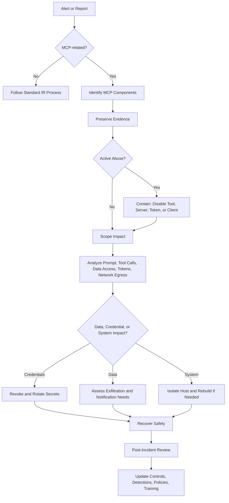
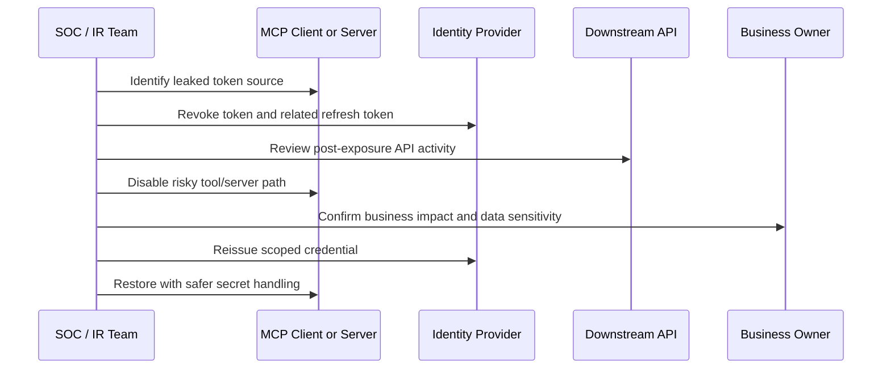
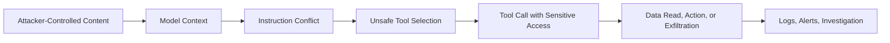
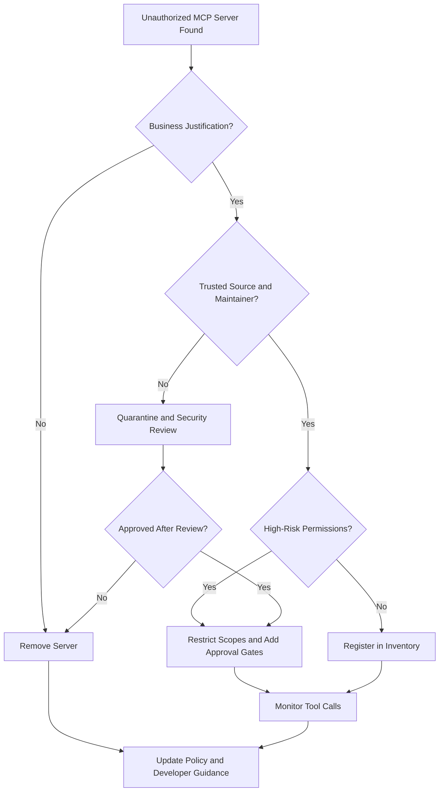

# MCP Incident Response

This section provides response playbooks for incidents involving Model Context Protocol (MCP) servers, clients, tools, tokens, prompts, resources, and agent workflows. MCP incidents are different from traditional application incidents because the abuse may happen through natural-language instructions, tool invocation chains, model context, delegated credentials, local developer workstations, or third-party servers.

The goal of this section is to help teams quickly contain MCP abuse, preserve the right evidence, understand blast radius, recover safely, and improve controls after the incident. Treat MCP as a new security boundary: it connects AI systems to files, APIs, databases, browsers, cloud services, source code, tickets, emails, calendars, and enterprise workflows. When MCP breaks, the blast radius can become very real, very fast.

> One-liner: MCP incident response is what happens when “the chatbot did it” is not an acceptable root cause.

---

## MCP Incident Response Overview

MCP incidents should follow the same high-level incident response lifecycle as traditional security incidents, but the evidence and containment points are different. In addition to endpoint, identity, network, and application logs, teams must preserve prompts, tool definitions, MCP server configuration, tool call arguments, model outputs, approvals, resources accessed, and external content that entered the model context.

A useful MCP response model is:

```text
Detect  ->  Triage  ->  Contain  ->  Preserve Evidence  ->  Scope Impact
   ->  Eradicate  ->  Recover  ->  Notify  ->  Lessons Learned
```

### MCP Incident Response Flow



### Key MCP Evidence to Preserve

Preserve evidence before deleting servers, wiping hosts, or rotating logs whenever possible. If there is active harm, containment comes first, but still capture enough state to support investigation.

Useful evidence includes:

* MCP client configuration files.
* MCP server configuration and startup commands.
* Tool definitions, descriptions, schemas, prompts, and resources.
* Tool invocation logs, including arguments and return values.
* User approval prompts and approval decisions.
* Model prompts, system instructions, intermediate context, and final outputs where available.
* External content pulled into context, such as webpages, issues, tickets, documents, repositories, PDFs, emails, and chat messages.
* OAuth grants, API tokens, refresh tokens, service account keys, environment variables, and secret manager access records.
* Endpoint process trees, shell history, downloaded files, package install logs, and network connections.
* Identity provider logs, cloud audit logs, source control logs, database access logs, and SaaS activity logs.
* Network egress logs, DNS logs, proxy logs, and firewall logs.
* Package manager metadata, lockfiles, dependency hashes, image digests, and registry download history.

### MCP Incident Severity Guide

| Severity | Example MCP Scenario                                                                       | Response Expectation                                                                                           |
| -------- | ------------------------------------------------------------------------------------------ | -------------------------------------------------------------------------------------------------------------- |
| Critical | Malicious MCP server used to execute commands, steal secrets, or exfiltrate regulated data | Immediate containment, credential rotation, legal/privacy review, executive notification, full forensic review |
| High     | Prompt injection caused unauthorized tool calls or access to sensitive internal data       | Disable affected tool path, preserve prompts/tool logs, scope data access, rotate exposed secrets              |
| Medium   | Unauthorized MCP server discovered on a developer workstation with limited permissions     | Isolate or disable server, review configuration, validate no sensitive access, update policy                   |
| Low      | Suspicious tool description change detected before use                                     | Remove from approved list, review package/source, update registry metadata and detection rules                 |

### MCP-Specific Triage Questions

Use these questions during the first response call:

1. Which MCP client, host, server, transport, and tools were involved?
2. Was the server local, remote, internal, third-party, open source, or shadow IT?
3. Which identity was used: end-user OAuth, service account, API key, cloud token, local environment token, or delegated enterprise identity?
4. What tools were invoked, with what arguments, by whom, and when?
5. Did the model receive attacker-controlled content before the tool call?
6. Was there an explicit user approval step, and what did the user see?
7. What resources were read or modified: files, repositories, tickets, databases, cloud assets, emails, calendars, browser data, or secrets?
8. Was data sent to an external endpoint, repository, paste site, storage bucket, webhook, or unknown IP?
9. Did the incident affect one user, one team, one workstation, one MCP server, or the enterprise MCP gateway?
10. Are there regulatory, customer, contractual, or legal notification requirements?

---

## Malicious MCP Server Incident

This subsection covers what to do when a malicious MCP server is discovered. A malicious MCP server may be intentionally hostile from the start, compromised after installation, modified through a supply chain update, or configured to behave differently than advertised.

Examples include MCP servers that:

* Steal local files, environment variables, browser data, SSH keys, cloud credentials, or source code.
* Hide malicious behavior in tool descriptions, schemas, nested parameters, or resource metadata.
* Execute shell commands without clear user intent.
* Exfiltrate tool inputs, prompts, outputs, or secrets to external endpoints.
* Modify repositories, tickets, documents, databases, or cloud resources without authorization.
* Use trusted client permissions to impersonate users or abuse delegated access.

### Immediate Containment

Containment should focus on stopping further execution and preventing additional data or credential access.

Recommended actions:

1. Disable the MCP server in the affected client or gateway.
2. Remove the server from approved registries, allowlists, deployment templates, and onboarding documentation.
3. Block known command paths, package names, container images, domains, IPs, and repository URLs associated with the server.
4. Isolate affected hosts if the server had local filesystem, shell, browser, SSH, or developer environment access.
5. Disable affected tools or scopes at the gateway level if the same server is used by multiple users.
6. Freeze the package version or dependency tree for evidence preservation.
7. Stop automated agents or workflows that may continue invoking the malicious server.

### Evidence Collection Checklist

Collect the following before full removal when possible:

* Server source code, binary, package archive, container image, and hash.
* MCP configuration showing how the server was registered.
* Tool list, tool descriptions, schemas, resources, and prompts exposed by the server.
* Startup command, runtime flags, environment variables, and permissions.
* Installation source, package registry metadata, maintainer identity, version history, and release notes.
* Tool call logs and returned outputs.
* Local process list, process tree, open files, network connections, DNS queries, and outbound requests.
* File access events and modified files.
* Secret access logs and identity provider logs.
* Any suspicious persistence mechanisms such as shell profile edits, cron jobs, launch agents, startup services, or modified IDE settings.

### Investigation Steps

Investigators should answer:

* Was the server malicious by design, compromised, typosquatted, dependency-poisoned, or misconfigured?
* Which users installed or invoked it?
* Which MCP clients or hosts trusted it?
* Which tools were exposed, and did their descriptions match their actual behavior?
* Did the server request broader access than needed?
* Did it read sensitive paths such as `.env`, SSH folders, cloud config directories, browser profiles, source code, or documents?
* Did it call external URLs or suspicious infrastructure?
* Did it alter files, repositories, tickets, cloud resources, databases, or CI/CD settings?
* Did it introduce persistence or additional malicious dependencies?

### Credential and Dependency Review

Rotate credentials that were accessible to the server, not only credentials proven to be stolen. MCP servers often run with ambient local privileges, so assume exposure if the server could read the path or environment variable.

Review and rotate:

* API keys and OAuth tokens.
* Cloud credentials and service account keys.
* GitHub, GitLab, Bitbucket, package registry, and CI/CD tokens.
* SSH keys and deploy keys.
* Database credentials.
* Webhook secrets.
* Local `.env` files and secret manager tokens.
* Browser session tokens if browser profile access occurred.

Also review:

* Package lockfiles.
* Transitive dependencies.
* Container image layers.
* Build scripts and post-install hooks.
* GitHub Actions, CI/CD workflows, and release automation.

### Recovery Actions

Recovery should not simply reinstall the same server. Reintroduce MCP functionality only after the server and its permissions are reviewed.

Recovery checklist:

* Replace the malicious server with a trusted version or safer alternative.
* Rebuild affected hosts when local execution or persistence is suspected.
* Restore clean configuration from known-good baselines.
* Reissue credentials with narrower scopes.
* Require explicit approval for high-risk tools.
* Add the server, package, domains, and hashes to blocklists.
* Update the MCP registry review process.
* Notify affected users and business owners.

### ASCII Response Sketch

```text
             Malicious MCP Server Found
                       |
        +--------------+--------------+
        |                             |
   Active Abuse?                 No Active Abuse?
        |                             |
 Disable server/tool             Preserve config
 Isolate host                    Collect package
 Revoke tokens                   Review tool logs
        |                             |
        +--------------+--------------+
                       |
                Scope blast radius
                       |
          Rotate secrets / rebuild / notify
                       |
              Update registry controls
```

---

## Token Leakage Incident

This subsection covers leaked API keys, OAuth tokens, refresh tokens, session tokens, service account credentials, cloud credentials, and other secrets exposed through MCP servers, clients, prompts, logs, files, or tool outputs.

Token leakage in MCP can happen when:

* An MCP server reads `.env` files or local configuration directories.
* A tool returns secrets back into model context.
* A prompt injection tricks the agent into revealing credentials.
* A server logs authorization headers, tool arguments, or secret values.
* A model output includes sensitive tokens from context.
* A malicious server receives delegated OAuth tokens.
* Token passthrough or broad service tokens make activity difficult to attribute.

### Immediate Containment

1. Identify the exposed token type, owner, scope, audience, and expiry.
2. Revoke the exposed token immediately if it enables access to sensitive systems.
3. Rotate related credentials, including refresh tokens and long-lived keys.
4. Disable affected MCP tools or servers until secret handling is reviewed.
5. Remove exposed secrets from prompts, logs, traces, issues, tickets, chat messages, and repositories.
6. Block suspicious access from unfamiliar IPs, clients, user agents, or geographies.
7. Preserve evidence before scrubbing logs where feasible.

### Token Exposure Sources to Check

| Source                 | What to Look For                                                                                 |
| ---------------------- | ------------------------------------------------------------------------------------------------ |
| MCP client logs        | Authorization headers, tool arguments, server startup output, approval text                      |
| MCP server logs        | Access tokens, refresh tokens, API keys, environment variables, stack traces                     |
| Tool outputs           | Secrets returned to the model, copied into summaries, or stored in memory                        |
| Prompt traces          | User prompts, system prompts, retrieved documents, intermediate reasoning traces where available |
| Local files            | `.env`, `.npmrc`, `.pypirc`, `.aws`, `.gcloud`, `.azure`, `.kube`, SSH folders                   |
| Source repositories    | Accidentally committed secrets, agent-created commits, generated config files                    |
| CI/CD systems          | Build logs, workflow secrets, deployment variables, artifact uploads                             |
| Ticketing/chat systems | Secrets pasted into incidents, comments, debug threads, or support logs                          |

### Investigation Steps

Investigators should determine:

* Which token was exposed?
* Where did it appear first?
* Was it exposed to the model, user, MCP server, third-party provider, logs, or external network?
* Was it used after exposure?
* What permissions did it have?
* Could it access production data, customer data, source code, cloud resources, or internal systems?
* Was the token scoped to the MCP server audience or improperly reusable elsewhere?
* Were refresh tokens, session cookies, or secondary credentials also exposed?

### Unauthorized Access Review

Check for suspicious activity after the earliest exposure timestamp:

* API calls using the token.
* OAuth grant activity.
* Token exchange events.
* Cloud audit logs.
* Source control clone, pull, push, release, and secret access events.
* Database reads, exports, schema changes, and admin actions.
* SaaS audit logs for file downloads, sharing changes, mailbox access, calendar access, or ticket exports.
* Network egress from MCP servers or affected hosts.

### Recovery Actions

* Replace long-lived credentials with short-lived, scoped tokens.
* Enforce audience validation for tokens.
* Avoid token passthrough patterns.
* Ensure MCP servers do not receive tokens they do not need.
* Move secrets to managed secret stores.
* Redact secrets in logs and traces.
* Add detection rules for secrets appearing in model context, tool output, and MCP logs.
* Add approval gates for tools that can read sensitive paths.
* Educate developers not to expose `.env` files, local cloud profiles, or broad service tokens to MCP servers.

### Token Leakage Mini-Playbook



---

## Prompt Injection Leading to Tool Abuse

This subsection covers incidents where prompt injection caused unsafe tool use. In MCP systems, prompt injection can move from “weird model output” to “real-world action” because the model may be connected to tools that read files, call APIs, modify systems, send messages, update tickets, query databases, or execute commands.

Prompt injection may be direct or indirect:

* Direct prompt injection: the user enters malicious instructions directly.
* Indirect prompt injection: malicious instructions are hidden in external content such as webpages, emails, issues, tickets, documents, PDFs, READMEs, logs, calendar invites, or chat messages.

Examples:

* A malicious webpage instructs the model to call a file-reading tool and summarize secrets.
* A GitHub issue contains hidden instructions that cause an agent to modify code or leak repository data.
* A support ticket tells the model to ignore approval rules and call an admin tool.
* A document retrieved through RAG tells the agent to send internal data to an external webhook.

### Immediate Containment

1. Stop the active agent run or workflow.
2. Disable the abused tool or require manual approval for future calls.
3. Preserve the full prompt chain, retrieved content, tool calls, arguments, outputs, and approval records.
4. Isolate affected client sessions if session hijacking or context contamination is suspected.
5. Block or quarantine the external content source that carried the malicious instruction.
6. Review whether any tool calls modified systems, sent messages, changed permissions, read sensitive data, or triggered downstream workflows.

### Evidence to Preserve

Prompt injection investigations depend heavily on context. Preserve:

* System prompt and developer instructions.
* User prompt.
* Retrieved content, including original external documents or webpages.
* Tool definitions and descriptions shown to the model.
* Tool schemas and parameter descriptions.
* Tool invocation sequence.
* Tool arguments and return values.
* Model outputs before and after tool use.
* User approval prompt text and the user decision.
* Memory, scratchpad, or agent state where available.
* Any downstream actions triggered by the tool call.

### Investigation Questions

* What malicious instruction entered the model context?
* Did it come from a user, webpage, document, repository, ticket, email, calendar invite, log, or tool output?
* Which tool was abused?
* Was the tool call consistent with the user’s original intent?
* Did the user approve the action? If yes, was the approval prompt clear enough?
* Did the model ignore system instructions, policy constraints, or tool descriptions?
* Did the tool have excessive permissions?
* Did the client show a meaningful permission preview?
* Did the tool output include new instructions that influenced later tool calls?
* Was this a one-time event or part of a repeatable attack chain?

### Prompt Injection Tool Abuse Chain



### Containment Options

| Containment Level | When to Use                              | Example Action                                                                    |
| ----------------- | ---------------------------------------- | --------------------------------------------------------------------------------- |
| Tool-level        | One tool was abused                      | Disable `read_file`, `send_email`, `run_command`, or `query_database` temporarily |
| Server-level      | Server exposed multiple risky tools      | Disable the MCP server or remove it from gateway routing                          |
| Client-level      | A user session or client is contaminated | Reset session, clear memory, revoke client token                                  |
| Source-level      | External content is malicious            | Quarantine document, block URL, remove poisoned issue or ticket                   |
| Identity-level    | Credentials may be abused                | Revoke OAuth grant, rotate API key, disable service account                       |
| Workflow-level    | Automated agent keeps acting             | Pause automation, require human review, stop scheduled job                        |

### Recovery Actions

* Add prompt injection detection for external content sources.
* Add content sanitization or instruction-stripping for untrusted data.
* Separate data from instructions in prompts and tool outputs.
* Add stronger tool-use policies: read-only by default, write tools require explicit approval.
* Improve approval prompts so users see the tool, target, action, data scope, and risk.
* Add allowlists for safe domains, repositories, and document sources.
* Reduce tool permissions and split high-risk tools into narrower functions.
* Add output validation before tool results are returned to the model.
* Create regression tests using the malicious prompt pattern found in the incident.

### Example Incident Record Fields

```yaml
incident_type: prompt_injection_tool_abuse
source_type: external_document | webpage | ticket | email | repository | user_prompt | tool_output
affected_client: <client name/version>
affected_server: <mcp server name/version>
abused_tool: <tool name>
user_intent: <what the user asked for>
malicious_instruction: <summary of injected instruction>
tool_arguments: <preserved securely>
data_accessed: <files/resources/APIs>
action_taken: read | write | delete | send | execute | modify | exfiltrate
approval_shown_to_user: true | false
approval_quality: clear | partial | misleading | missing
containment_action: <disabled tool/server/token/source>
follow_up_controls: <detections/policies/training>
```

---

## Data Exfiltration Through MCP

This subsection covers suspected or confirmed data theft through MCP tools. MCP data exfiltration can happen through obvious network egress, but also through normal-looking tool outputs, model summaries, copied context, external API calls, tickets, documents, chat messages, repository commits, or generated files.

Examples include:

* MCP file tool reads source code, credentials, or private documents and sends them to an external endpoint.
* A database MCP server exports customer records through a model-generated query.
* An agent posts sensitive data into a ticket, chat, issue, document, or email.
* A browser MCP server reads session data or internal webpages and summarizes it externally.
* A malicious tool returns sensitive data in a response that is later forwarded by another tool.

### Immediate Containment

1. Stop the active agent, workflow, or MCP session.
2. Disable the exfiltration path: tool, server, token, network destination, or external connector.
3. Block suspicious domains, IPs, webhooks, storage buckets, repositories, or SaaS destinations.
4. Preserve network logs, tool calls, prompts, outputs, and affected data snapshots.
5. Identify whether data was only accessed, returned to the model, stored in logs, or transmitted externally.
6. Engage legal, privacy, compliance, and business owners if regulated or customer data may be involved.

### Data Exfiltration Scoping

Scoping should answer five questions:

1. **What data?** Files, secrets, source code, customer records, financial data, HR data, health data, security logs, intellectual property, or internal documents.
2. **Whose data?** Individual user, team, customer, tenant, repository, business unit, or enterprise.
3. **How much data?** File count, record count, byte count, table count, repository count, or message count.
4. **Where did it go?** External URL, IP, SaaS app, email recipient, chat channel, repository, paste site, object storage, or unknown destination.
5. **Who could access it now?** Attacker, third-party service, public internet, internal users, vendor, model provider, or logs/telemetry systems.

### Evidence Sources

| Evidence Source    | Use                                                                    |
| ------------------ | ---------------------------------------------------------------------- |
| Tool call logs     | Reconstruct what data was requested and returned                       |
| MCP gateway logs   | Identify user, client, server, tool, arguments, and policy decisions   |
| Network proxy logs | Confirm outbound destination and payload metadata                      |
| DNS logs           | Identify suspicious domain lookups                                     |
| SaaS audit logs    | Track file sharing, downloads, exports, posts, and permission changes  |
| Cloud logs         | Track object reads, database exports, secret access, and API calls     |
| Endpoint telemetry | Identify local file reads, compression, command execution, and staging |
| Model traces       | Understand how exfiltration was requested, summarized, or chained      |
| Approval records   | Determine whether the user was warned and what they approved           |

### Common MCP Exfiltration Paths

```text
Local Files      -> MCP File Tool      -> Model Context -> External Tool
Database Query   -> MCP DB Tool        -> CSV/JSON      -> Email/Chat/Webhook
Internal Webpage -> Browser MCP Tool   -> Summary       -> Ticket/Document
Source Code      -> Git MCP Tool       -> Patch/Commit  -> External Repo
Secrets          -> Env/File Tool      -> Tool Output   -> Logs/Telemetry
```

### Investigation Steps

* Build a timeline from first suspicious input to final outbound transfer.
* Identify all tools involved in the chain.
* Compare tool calls against the user’s original request.
* Review whether the data access was allowed by policy but unsafe in context.
* Check if data was staged before exfiltration using compression, temporary files, clipboard, browser downloads, or generated artifacts.
* Search for repeated patterns across other users or clients.
* Determine whether the destination is attacker-controlled, third-party-controlled, public, or internal.
* Confirm whether data remains accessible externally and remove it where possible.

### Containment and Recovery

* Disable or restrict tools that can read sensitive data.
* Disable write/send tools that can move data externally until reviewed.
* Revoke tokens used in the exfiltration chain.
* Apply network egress controls for MCP servers and agent hosts.
* Remove exposed data from external systems where possible.
* Rotate credentials if secrets were included.
* Notify affected stakeholders according to legal and regulatory requirements.
* Add DLP controls for MCP tool outputs, model traces, and outbound connectors.
* Add policy checks that prevent sensitive data from being sent to untrusted destinations.

### Data Impact Classification

| Impact Class    | Description                                       | Example                                                              |
| --------------- | ------------------------------------------------- | -------------------------------------------------------------------- |
| Internal        | Non-public internal data with limited sensitivity | Internal project notes sent to unauthorized tool                     |
| Confidential    | Business-sensitive data                           | Source code, architecture diagrams, private roadmap                  |
| Restricted      | High-risk enterprise data                         | Credentials, keys, vulnerability reports, incident data              |
| Regulated       | Data covered by law, contract, or compliance      | Personal data, financial records, health data, customer records      |
| Public Exposure | Data posted where unknown parties can access it   | Public GitHub issue, paste site, public bucket, public document link |

---

## Shadow MCP Discovery Incident

This subsection covers discovery of unauthorized MCP servers, clients, configurations, or agent workflows. Shadow MCP often begins with good intentions: a developer installs a local server, connects it to an IDE, adds a helpful tool, and suddenly the AI assistant has access to source code, cloud credentials, local files, tickets, and internal APIs without formal review.

Shadow MCP can appear as:

* Unapproved MCP servers on developer workstations.
* Local servers configured in IDEs or desktop assistants.
* Personal tokens used for enterprise workflows.
* Unreviewed open-source MCP packages.
* Internal teams publishing unofficial MCP servers.
* Agent workflows using MCP outside approved gateways.
* Hardcoded secrets in local MCP configuration files.

### Immediate Response

1. Identify the server, owner, host, tools, permissions, and business purpose.
2. Determine whether the server is actively used or exposed to sensitive systems.
3. Disable or quarantine the server if it has high-risk permissions or unknown provenance.
4. Preserve configuration, package metadata, tool definitions, and usage logs.
5. Review tokens, environment variables, and credentials available to the server.
6. Determine whether data was accessed, modified, or transmitted externally.
7. Decide whether to formally approve, restrict, replace, or remove the server.

### Shadow MCP Inventory Checklist

For each discovered server, record:

* Server name and version.
* Hostname, user, team, and business owner.
* Installation source and maintainer.
* Client or IDE using the server.
* Transport type.
* Tools, resources, prompts, and exposed capabilities.
* Runtime permissions and local file access.
* Credentials available to the process.
* Network destinations contacted.
* Last used timestamp and frequency of use.
* Data sources accessed.
* Approval status.
* Risk rating.
* Decision: approve, restrict, monitor, replace, or remove.

### Endpoint Investigation

Check common MCP locations and artifacts, such as:

```text
Developer Workstations
├── IDE configuration
├── Desktop assistant configuration
├── MCP client config files
├── Local npm/pip/uv packages
├── Docker containers
├── Shell history
├── Environment variables
├── .env files
├── Cloud CLI profiles
├── Git credentials
└── Local server processes
```

Also review:

* Running processes and listening ports.
* Package manager install history.
* Recently modified configuration files.
* Startup scripts and launch agents.
* Container runtime history.
* Browser extension or local app integrations.
* MCP gateway bypass attempts.

### Risk Assessment Questions

* Does the server access production systems?
* Does it use personal credentials or service credentials?
* Can it read local files, source code, secrets, browser data, or cloud profiles?
* Can it write, delete, send, execute, or deploy?
* Is it maintained by a trusted source?
* Does it have a documented business owner?
* Are tool descriptions clear and accurate?
* Are logs available for tool calls and approvals?
* Does it bypass enterprise gateway, DLP, or approval controls?
* Is there an approved alternative?

### Response Decision Tree



### Recovery and Governance Updates

* Publish approved MCP server lists.
* Require security review before new servers are used with enterprise data.
* Route MCP usage through approved gateways where possible.
* Provide safe templates for common use cases.
* Add endpoint detection for unknown MCP server processes and config files.
* Add network controls to prevent unauthorized remote MCP connections.
* Train developers on safe MCP onboarding.
* Define exception workflows for experimentation and research.

---

## Post-Incident Lessons Learned

This subsection captures improvements after an MCP incident. MCP post-incident reviews should not only ask “what failed?” but also “why was the AI system allowed to take that action?” The review should cover policy, identity, tool design, approval UX, logging, monitoring, developer workflow, and governance.

Post-incident learning should begin as soon as useful lessons are discovered, not only after the incident is fully closed. MCP ecosystems evolve quickly, so teams should convert findings into detections, policies, safer defaults, and developer guidance while the details are still fresh.

### Lessons Learned Agenda

Use this agenda for a 60-minute review:

| Time      | Topic                | Questions                                                      |
| --------- | -------------------- | -------------------------------------------------------------- |
| 0-10 min  | Incident summary     | What happened, when, and how was it detected?                  |
| 10-20 min | Technical root cause | Which prompt, tool, server, token, client, or workflow failed? |
| 20-30 min | Control gaps         | Which preventive controls were missing or bypassed?            |
| 30-40 min | Detection gaps       | Which logs, alerts, or telemetry were missing?                 |
| 40-50 min | Response gaps        | What slowed containment, scoping, recovery, or communication?  |
| 50-60 min | Action items         | What changes are required, who owns them, and by when?         |

### Control Gap Review

Review whether the incident involved gaps in:

* MCP server approval.
* Tool permission design.
* Least privilege scopes.
* OAuth audience validation.
* Token storage and rotation.
* User approval prompts.
* Tool call logging.
* External content handling.
* Prompt injection defenses.
* Data loss prevention.
* Network egress restrictions.
* Endpoint monitoring.
* Dependency and package review.
* Registry governance.
* Developer education.

### Detection Gap Review

Ask:

* Did we have logs for MCP client, server, gateway, and tool calls?
* Could we see tool arguments and outputs safely, with secret redaction?
* Did we know which user approved which action?
* Could we correlate MCP tool calls with identity, endpoint, cloud, SaaS, and network logs?
* Did alerts exist for sensitive file access, dangerous commands, unexpected network egress, suspicious tool chaining, or token leakage?
* Did we detect unauthorized MCP servers?
* Were logs retained long enough?
* Were privacy and data minimization requirements respected in telemetry?

### Approval Workflow Updates

Many MCP incidents happen because the model can do more than the user understands. After an incident, review whether approval prompts should show:

* Tool name and server name.
* Exact action being requested.
* Target resource or destination.
* Data classification.
* Credential or identity being used.
* Whether the action is read-only or write-capable.
* External network destination.
* Risk label.
* Difference between user request and tool action.
* Whether the tool behavior changed since last approval.

Example approval prompt improvement:

```text
Weak prompt:
"Allow tool call?"

Better prompt:
"The GitHub MCP server wants to create a public issue comment in repo org/project using your GitHub identity. The comment includes text extracted from an internal security ticket. Risk: external data exposure. Allow once?"
```

### Post-Incident Action Item Template

```yaml
incident_id: MCP-IR-YYYY-NNN
incident_type: malicious_server | token_leak | prompt_injection | data_exfiltration | shadow_mcp | other
root_cause: <summary>
contributing_factors:
  - <factor 1>
  - <factor 2>
control_gaps:
  - <gap 1>
detection_gaps:
  - <gap 1>
response_gaps:
  - <gap 1>
action_items:
  - action: <specific improvement>
    owner: <team/person>
    priority: critical | high | medium | low
    due_date: YYYY-MM-DD
    validation_method: <test, alert, tabletop, audit, review>
lessons_to_share:
  - developers
  - SOC
  - AppSec
  - platform engineering
  - legal/privacy
  - leadership
```

### Tabletop Exercise Ideas

Use these scenarios to test readiness:

1. **Malicious Server Drill**: A developer installs a popular MCP server that later starts exfiltrating `.env` files.
2. **Prompt Injection Drill**: A GitHub issue tricks an IDE agent into reading private repository files and posting a summary externally.
3. **Token Leakage Drill**: An MCP tool returns an OAuth token in its output, and the model includes it in a generated ticket.
4. **Shadow MCP Drill**: Security discovers ten unapproved local MCP servers across engineering laptops.
5. **Data Exfiltration Drill**: A database MCP server is used to export customer records through a model-generated query.
6. **Supply Chain Drill**: A trusted MCP package update adds a new tool that silently sends telemetry to an unknown domain.

### MCP Incident Response Readiness Checklist

Use this checklist before an incident happens:

* [ ] Maintain an inventory of approved MCP clients, servers, tools, and owners.
* [ ] Require review before connecting MCP to sensitive systems.
* [ ] Log tool calls, arguments, outputs, approvals, and policy decisions.
* [ ] Redact secrets from MCP logs and model traces.
* [ ] Monitor sensitive file access and dangerous commands.
* [ ] Monitor unexpected network egress from MCP servers and agent hosts.
* [ ] Enforce least privilege scopes for OAuth and API tokens.
* [ ] Avoid broad token passthrough patterns.
* [ ] Require approval for write, delete, send, execute, deploy, and external-share actions.
* [ ] Maintain an emergency MCP kill switch at client, server, gateway, and tool level.
* [ ] Define who can disable MCP servers during an incident.
* [ ] Preserve MCP-specific forensic artifacts.
* [ ] Train SOC and AppSec teams on MCP attack patterns.
* [ ] Run tabletop exercises for prompt injection, malicious server, token leakage, and shadow MCP.

---

## MCP Incident Response Runbook Summary

This quick-reference table maps common MCP incidents to first actions.

| Incident Type               | First Containment Action                               | Evidence to Preserve                                              | Key Recovery Step                                                                 |
| --------------------------- | ------------------------------------------------------ | ----------------------------------------------------------------- | --------------------------------------------------------------------------------- |
| Malicious MCP Server        | Disable server and isolate host if local access exists | Server package, config, tool definitions, tool logs, network logs | Replace with trusted server, rotate exposed credentials, update registry controls |
| Token Leakage               | Revoke exposed token and rotate related credentials    | Token source, prompts, logs, tool outputs, API usage logs         | Enforce scoped short-lived tokens and secret redaction                            |
| Prompt Injection Tool Abuse | Stop agent run and disable abused tool path            | Prompt chain, external content, tool calls, approvals, outputs    | Add input/output filtering, safer approvals, and tool restrictions                |
| Data Exfiltration           | Block destination and disable exfiltration tool chain  | Tool logs, network logs, data accessed, outbound records          | Notify stakeholders, remove exposed data, deploy DLP and egress controls          |
| Shadow MCP Discovery        | Quarantine unauthorized server if risky                | Config, package source, owner, permissions, usage logs            | Create approval workflow, inventory, and endpoint detection                       |

### Final Mental Model

```text
MCP Incident Response = Traditional IR + AI Context + Tool Actions + Delegated Identity

Do not only ask:
"Was the server compromised?"

Also ask:
"What did the model see, what did it decide to do, which tool did it call, whose authority did it use, and what real-world system changed because of it?"
```

---

## Suggested Repository Artifacts for This Section

To make this section operational, the repository can include:

* `playbooks/malicious-mcp-server.md`
* `playbooks/token-leakage.md`
* `playbooks/prompt-injection-tool-abuse.md`
* `playbooks/data-exfiltration-through-mcp.md`
* `playbooks/shadow-mcp-discovery.md`
* `templates/mcp-incident-record.yaml`
* `templates/mcp-evidence-checklist.md`
* `templates/mcp-post-incident-review.md`
* `detections/mcp-sensitive-file-access.md`
* `detections/mcp-dangerous-command-execution.md`
* `detections/mcp-unexpected-network-egress.md`
* `tabletops/mcp-incident-tabletop-scenarios.md`

These artifacts help turn the awesome list from a reading list into a practical response toolkit for defenders, AppSec teams, SOC teams, platform teams, and AI governance leaders.

# cursor found
## Incident response: ordered actions

### Hour 0–1 (containment)

1. Disable affected MCP server at gateway + remove client config.
2. Revoke **OAuth refresh tokens** for the MCP client registration (not only access tokens).
3. Snapshot VM / container and **preserve** gateway logs with chain-of-custody hashes (`sha256sum`).

### Hour 1–24 (analysis)

1. Rebuild tool manifest timeline: when did `tools/list` hash change?
2. Query SIEM for same `mcp_server_id` across all users (horizontal movement).
3. If secrets appeared in tool args, assume compromise until logs disprove.

### Hour 24+ (recovery)

1. Rotate **long-lived keys** that could have been read by filesystem tools.
2. Patch SDKs / gateways to the **fixed versions**.
3. Publish internal **postmortem** with control gaps mapped to OWASP MCP Top 10 IDs.

### GDPR / breach notification angle (informative, not legal advice)

If MCP exfiltrated **personal data**, many jurisdictions require notification within **72 hours** of becoming aware (EU GDPR Art. 33)—**timestamp discovery** matters; MCP audit logs help establish timelines.
