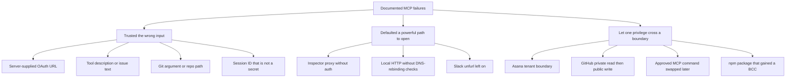

# Case Studies

This section records **documented** MCP security cases: production incidents, vendor and researcher advisories, and controlled research demonstrations. Every entry names the affected component, the disclosure date, the evidence level, and the primary sources.

Nothing in this chapter is a fictional company, a made-up CVE, or an invented enterprise rollout. Where public sources disagree, the disagreement is stated. Where exploitation in the wild was not reported, that is stated too.

> **One-liner:** A case study is only useful if a reader can open the advisory and check the claim.

---

## How to read a case

| Label | Meaning | What this chapter uses it for |
| ----- | ------- | ------------------------------ |
| `CONFIRMED_INCIDENT` | A deployed product or package was affected, and public reporting describes customer, user, or supply-chain impact. | Asana MCP exposure; malicious `postmark-mcp` package. |
| `CONFIRMED_VULNERABILITY` | A CVE, GHSA, or vendor advisory exists. Exploitation in the wild may still be unreported. | MCP Inspector, `mcp-remote`, SDK DNS rebinding, `mcp-server-git`, Slack MCP server, Cursor MCPoison, `oatpp-mcp`. |
| `RESEARCH_DEMO` | A controlled demonstration by the researchers, usually against their own accounts or lab clients. | Invariant Labs tool poisoning, WhatsApp exfiltration, GitHub MCP toxic flow. |

Recommended header:

```markdown
**Status:** CONFIRMED_VULNERABILITY
**Exploitation in the wild:** Not publicly reported
**Safety note:** Mechanism and impact only. No exploit payloads.
```

This chapter does not include weaponized tool descriptions, command strings, or step-by-step reproduction. Follow the linked advisories for patch details.

---

## Case index

| Case | Status | Date | Component | What failed |
| ---- | ------ | ---- | --------- | ----------- |
| [Asana MCP cross-organization exposure](#case-asana-mcp-cross-organization-data-exposure) | `CONFIRMED_INCIDENT` | Bug found 2025-06-04; feature offline 2025-06-05 to 2025-06-17 | Asana experimental MCP server | Tenant-isolation logic bug |
| [Malicious `postmark-mcp` npm package](#case-malicious-postmark-mcp-npm-package) | `CONFIRMED_INCIDENT` | Malicious release 2025-09-17; public alerts 2025-09-25 onward | Unofficial npm package `postmark-mcp` | Supply-chain backdoor that BCC’d email |
| [MCP Inspector missing proxy authentication](#case-mcp-inspector-missing-proxy-authentication) | `CONFIRMED_VULNERABILITY` | GHSA published 2025-06-13 | `@modelcontextprotocol/inspector` `< 0.14.1` | Unauthenticated local proxy could launch MCP commands |
| [`mcp-remote` command injection](#case-mcp-remote-os-command-injection) | `CONFIRMED_VULNERABILITY` | Published 2025-07-09 | `mcp-remote` `0.0.5`–`0.1.15` | Untrusted OAuth `authorization_endpoint` reached OS command execution |
| [Official Slack MCP server link unfurling](#case-anthropic-slack-mcp-server-link-unfurling) | `CONFIRMED_VULNERABILITY` | Reported 2025-05-27; CVE published 2025-07-02 | Deprecated Anthropic Slack MCP server | Agent-posted links were fetched by Slack preview bots |
| [Cursor MCPoison](#case-cursor-mcpoison-trusted-mcp-config-swap) | `CONFIRMED_VULNERABILITY` | Disclosed to Cursor 2025-07-16; public write-up 2025-08-05 | Cursor IDE MCP approval | A previously approved MCP command could be swapped without a new prompt |
| [`oatpp-mcp` session hijacking](#case-oatpp-mcp-predictable-session-ids) | `CONFIRMED_VULNERABILITY` | Published 2025-10-20 | `oatpp-mcp` SSE transport | Session ID was an instance pointer, not a cryptographic random value |
| [Python and TypeScript SDK DNS rebinding](#case-mcp-sdk-dns-rebinding-defaults) | `CONFIRMED_VULNERABILITY` | Published 2025-12-02 | Python `mcp` `< 1.23.0`; TypeScript SDK `< 1.24.0` | Local unauthenticated HTTP servers did not enable DNS-rebinding protection by default |
| [`mcp-server-git` path and argument bugs](#case-mcp-server-git-path-and-argument-bugs) | `CONFIRMED_VULNERABILITY` | Advisories published 2025-12-17 and 2025-12-18 | Reference `mcp-server-git` | Unrestricted `git_init`, flag injection, and repository-boundary bypass |
| [Tool poisoning](#case-invariant-labs-tool-poisoning) | `RESEARCH_DEMO` | 2025-04-01 | MCP clients that trust tool metadata | Hidden instructions in tool descriptions steered the agent |
| [WhatsApp history exfiltration](#case-invariant-labs-whatsapp-mcp-exfiltration) | `RESEARCH_DEMO` | 2025-04-07; follow-up 2025-04-09 | Trusted WhatsApp MCP plus an untrusted server, and later a poisoned message | Cross-server tool shadowing and a rug pull |
| [GitHub MCP toxic agent flow](#case-invariant-labs-github-mcp-toxic-agent-flow) | `RESEARCH_DEMO` | 2025-05-26 | Official GitHub MCP server with a broad user token | Public issue text steered a trusted agent into a private-to-public leak |

---

## Confirmed incidents

### Case: Asana MCP cross-organization data exposure

**Status:** CONFIRMED_INCIDENT
**Affected component:** Asana’s experimental MCP server, a hosted SaaS integration
**Disclosure:** Bug identified 2025-06-04; customer reporting and press coverage around 2025-06-16 to 2025-06-18
**CVE / Advisory:** No public CVE. Vendor status updates plus customer notices reported by UpGuard, BleepingComputer, The Register, and CSO Online.
**Severity:** Not scored as a CVE. Business impact is cross-tenant data exposure inside a production SaaS feature.
**Exploitation in the wild:** Asana described a logic bug, not an external intrusion. Public reporting does not identify a named external attacker.
**Primary risk category:** Broken tenant isolation / authorization

#### What happened

Asana launched an MCP server on **2025-05-01** so AI applications could query the Asana work graph. On **2025-06-04** Asana identified a bug in that server. The feature was taken offline on **2025-06-05** and returned on **2025-06-17**. Asana’s status page recorded the maintenance window and the return to service at 17:00 UTC on June 17.

Customer language reported by UpGuard said the bug “could have potentially exposed certain information from your Asana domain to other Asana MCP users” inside the projects, teams, tasks, and other objects allowed by the MCP user’s permissions. BleepingComputer described the same boundary: another MCP user might see data from a different organization, limited to what that user’s permissions could already reach. The exposed object types called out in that reporting were task information, project metadata, team details, comments and discussions, and uploaded files.

This was not a public dump of every Asana workspace. It was a failure of organization boundaries inside an opt-in AI connector.

BleepingComputer reported that an Asana spokesperson said the incident affected roughly **1,000 customers**. The Register, covering the same period, reported that a spokesperson had not answered its questions about how many customers were affected and whether anyone actually viewed the data. Those two accounts should be read together: the customer-count figure comes from one outlet’s interview, and Asana did not publish a full public postmortem with a confirmed viewership count.

#### Timeline

| Date (2025) | Event | Source |
| ----------- | ----- | ------ |
| May 1 | Experimental MCP server launched. | BleepingComputer; The Register; UpGuard |
| June 4 | Asana identifies the bug. | BleepingComputer; The Register |
| June 5 | MCP feature taken offline for customers who had opted in. | Asana status, via IsDown archive; The Register |
| June 16 | Asana status says the code issue is resolved and the server is being reinstated. Customer notices circulate. | IsDown archive of the status page; press coverage |
| June 17, 17:00 UTC | MCP server reported operational. Existing connections were reset and had to be reconnected by hand. | Asana status; The Register; BleepingComputer |
| June 18 | BleepingComputer and The Register publish. | Press |

#### Root cause

- Authorization logic did not keep one organization’s MCP-visible objects inside that organization.
- The connector treated “this user may use MCP” as a sufficient boundary. Tenant isolation still had to be enforced on every object the model could ask for.
- The feature was explicitly experimental, and it still sat on production customer data.

#### Impact

- Confidentiality: another organization’s MCP user could potentially see tasks, projects, teams, comments, and files that fell inside the querying user’s permission scope.
- Integrity and availability: no public report of data modification. The service was unavailable to MCP users for about twelve days.
- Response cost: connection reset, manual reconnect, customer notification, and log review.

#### Detection and response ideas

- Review MCP access logs for queries whose results contain workspace or organization identifiers outside the caller’s tenant.
- Compare AI-generated summaries with the tenant that owned the source objects.
- Alert when one MCP credential reads object IDs that belong to a different organization.
- Keep a kill switch that can disable the connector without taking down the rest of the product. Asana used that path.

#### Remediation that was actually reported

- Took the MCP server offline.
- Fixed the code defect.
- Reset every MCP connection and required a manual reconnect.
- Notified organizations Asana considered impacted and offered a path to request logs and metadata.

#### Lessons

- An experimental AI connector is still a production authorization system if it can read customer objects.
- “Limited to the user’s permissions” is not tenant isolation. The user’s token must also be bound to one organization.
- Incident response for MCP includes disconnecting clients, not only shipping a code fix. Stale connections can keep using the broken path.

#### References

- [UpGuard — Asana discloses data exposure bug in MCP server](https://www.upguard.com/blog/asana-discloses-data-exposure-bug-in-mcp-server)
- [BleepingComputer — Asana warns MCP AI feature exposed customer data to other orgs](https://www.bleepingcomputer.com/news/security/asana-warns-mcp-ai-feature-exposed-customer-data-to-other-orgs/) (2025-06-18; includes the spokesperson’s “roughly 1,000 customers” statement)
- [The Register — Asana MCP server back online after plugging a data-leak hole](https://www.theregister.com/2025/06/18/asana_mcp_server_bug/)
- [CSO Online — Asana’s MCP AI connector could have exposed corporate data](https://www.csoonline.com/article/4009373/asanas-mcp-ai-connector-could-have-exposed-corporate-data-csos-warned.html)
- [IsDown archive of Asana’s June 2025 MCP maintenance updates](https://isdown.app/status/asana/incidents/397852-mcp-maintenance)

---

### Case: Malicious `postmark-mcp` npm package

**Status:** CONFIRMED_INCIDENT
**Affected component:** npm package `postmark-mcp`. This is **not** an official Postmark package and **not** the Postmark API.
**Disclosure:** Postmark public alert 2025-09-25; OSV `MAL-2025-47604` published 2025-09-26; Snyk advisory the same day
**CVE / Advisory:** `MAL-2025-47604`; Snyk `SNYK-JS-POSTMARKMCP-13052679` (CWE-506). No mainstream CVE number.
**Severity:** Snyk scored the malicious package 9.3 and marked exploit maturity as attacked, because the package itself was the attack.
**Exploitation in the wild:** Confirmed malicious release. The backdoor ran for anyone who installed the affected versions and sent mail through that MCP server.
**Primary risk category:** MCP server supply chain / rug pull

#### What happened

An npm publisher shipped a package named `postmark-mcp` that copied a legitimate Postmark MCP server maintained on GitHub. Postmark’s own statement is direct: Postmark did not develop, authorize, or publish that npm package, and the legitimate Postmark API was not affected.

The package behaved like a normal email MCP server across earlier versions. In **version 1.0.16** the publisher added a blind carbon copy so mail sent through the server was also delivered to an external address. Open Source Vulnerabilities records the package as malicious starting at `1.0.16` and says it exfiltrates email data via BCC. Koi Security, which reported the behavior change, and later coverage in The Hacker News, identify the BCC destination as `phan@giftshop.club`.

The Hacker News, citing Koi, reported that npm user `phanpak` uploaded the package on **2025-09-15**, published `1.0.16` on **2025-09-17**, and that the package had **1,643** downloads before it was removed. Koi’s own write-up described on the order of **1,500 weekly downloads**. Use the figures as published by each source; they are not the same statistic. Deleting the package from npm does not remove it from machines that already installed it.

Postmark said the actor built trust over 15 versions and then added the backdoor in `1.0.16`.

#### Why the impact is larger than one BCC line

An MCP mail server sits inside the agent’s tool list. Password resets, invoices, alerts, and internal mail that the agent is allowed to send all pass through it. The backdoor did not need to break Postmark. It copied a trusted integration and waited until people depended on it.

#### Detection

Search outbound mail for a BCC to `giftshop.club` or `phan@giftshop.club` during the window the package was installed. Those indicators were published by Koi, Snyk, and The Hacker News specifically so defenders can hunt.

Also check:

- lockfiles and MCP client configs for `postmark-mcp`
- installed versions `>= 1.0.16`
- MCP server processes that send mail to a destination the application code does not show in its normal recipient fields

#### Remediation

- Remove `postmark-mcp` anywhere it is installed. npm removal is not enough.
- Rotate credentials, tokens, and password-reset links that were sent through the affected server.
- Review mail logs for the BCC domain above.
- Install MCP servers from a pinned official repository, not from a same-name package on a public registry.
- Treat an MCP server update like a dependency update: diff the tool code, not only the changelog.

#### Lessons

- The package name is not the vendor. Postmark had to publish a denial because the npm name looked official.
- A rug pull is a behavior change between two versions the client already trusts.
- MCP servers that can send, read, or store data are supply-chain components with production privileges.

#### References

- [Postmark — Security alert: malicious `postmark-mcp` npm package](https://postmarkapp.com/blog/information-regarding-malicious-postmark-mcp-package) (published 2025-09-25)
- [OSV `MAL-2025-47604`](https://osv.dev/vulnerability/MAL-2025-47604)
- [Snyk — Malicious package in `postmark-mcp`](https://security.snyk.io/vuln/SNYK-JS-POSTMARKMCP-13052679)
- [Koi Security — First malicious MCP in the wild](https://www.koi.ai/blog/postmark-mcp-npm-malicious-backdoor-email-theft)
- [The Hacker News — First malicious MCP server found stealing emails](https://thehackernews.com/2025/09/first-malicious-mcp-server-found.html)
- [Snyk blog — Malicious MCP server on npm](https://snyk.io/blog/malicious-mcp-server-on-npm-postmark-mcp-harvests-emails/)

---

## Confirmed vulnerabilities

### Case: MCP Inspector missing proxy authentication

**Status:** CONFIRMED_VULNERABILITY
**Affected component:** `@modelcontextprotocol/inspector` (npm), the official developer tool for testing MCP servers
**Disclosure date:** GitHub advisory published 2025-06-13
**CVE / Advisory:** [CVE-2025-49596](https://nvd.nist.gov/vuln/detail/CVE-2025-49596) / [GHSA-7f8r-222p-6f5g](https://github.com/advisories/GHSA-7f8r-222p-6f5g) / Tenable [TRA-2025-20](https://www.tenable.com/security/research/tra-2025-20)
**Severity:** Critical. Tenable scored CVSS 4.0 at 9.4 (`CVSS:4.0/AV:N/AC:L/AT:N/PR:N/UI:P/VC:H/VI:H/VA:H/SC:H/SI:H/SA:H`). CWE-306, missing authentication for a critical function.
**Affected versions:** All releases below `0.14.1`
**Fixed version:** `0.14.1` (fix commit `50df0e1ec488f3983740b4d28d2a968f12eb8979`)
**Credit:** Rémy Marot, Tenable Research
**Exploitation in the wild:** Not stated in the advisory
**Primary risk category:** Missing authentication on a developer proxy that can launch local MCP processes

#### Executive summary

MCP Inspector is the debugging UI and proxy developers use to talk to an MCP server. Before `0.14.1`, the proxy did not authenticate the caller. Anyone who could reach that proxy could send requests that launched MCP commands over stdio on the machine running Inspector.

Tenable’s write-up adds the browser angle: default instructions exposed the proxy without network restrictions, so a malicious website visited by the developer could target it. The researcher’s CVSS vector includes user interaction (`UI:P`) and no privileges (`PR:N`).

#### What the patch changed

Tenable reports that `0.14.1` changed the defaults:

- Authentication is required, using a session token, unless a developer explicitly turns it off.
- The service binds to localhost.
- Trusted origins are limited to localhost origins for the client port.

#### Impact

A developer workstation running a vulnerable Inspector could be driven into local command execution. That machine typically holds source code, cloud credentials, SSH keys, and the tokens configured for other MCP servers.

#### Detection ideas

- Inventory machines running `@modelcontextprotocol/inspector` and flag versions below `0.14.1`.
- Alert when the Inspector proxy listens on a non-loopback address.
- Log proxy requests that do not present the session token introduced in `0.14.1`.
- Watch for browser-origin requests to local Inspector ports. Tenable’s example of the default UI is `http://127.0.0.1:6274`.

#### Remediation

- Upgrade the package, and every project that vendors or launches it, to `0.14.1` or later.
- Do not disable the session token on a machine that browses the web.
- Keep the proxy on localhost.
- Run debugging proxies in a dev container when the tools they launch are powerful.

#### Lessons

- A debugger that can start a server is part of the attack surface.
- Localhost binding and an auth token are separate controls. The patch added both.
- “Only developers use it” does not reduce severity when the developer machine is the target.

#### References

- [GitHub Advisory GHSA-7f8r-222p-6f5g](https://github.com/advisories/GHSA-7f8r-222p-6f5g)
- [NVD CVE-2025-49596](https://nvd.nist.gov/vuln/detail/CVE-2025-49596)
- [Tenable Research Advisory TRA-2025-20](https://www.tenable.com/security/research/tra-2025-20)
- [Tenable blog — critical RCE in Anthropic MCP Inspector](https://www.tenable.com/blog/how-tenable-research-discovered-a-critical-remote-code-execution-vulnerability-on-anthropic)
- [Fix commit](https://github.com/modelcontextprotocol/inspector/commit/50df0e1ec488f3983740b4d28d2a968f12eb8979)

---

### Case: `mcp-remote` OS command injection

**Status:** CONFIRMED_VULNERABILITY
**Affected component:** npm package `mcp-remote`, a bridge that lets stdio-only MCP hosts talk to a remote HTTP MCP server. JFrog explicitly includes clients such as Claude Desktop when they are configured to use this bridge.
**Disclosure date:** JFrog published 2025-07-08; NVD published 2025-07-09
**CVE / Advisory:** [CVE-2025-6514](https://nvd.nist.gov/vuln/detail/CVE-2025-6514) / [GHSA-6xpm-ggf7-wc3p](https://github.com/advisories/GHSA-6xpm-ggf7-wc3p) / JFrog `JFSA-2025-001290844`
**Severity:** Critical. CVSS 3.1 base 9.6 (`CVSS:3.1/AV:N/AC:L/PR:N/UI:R/S:C/C:H/I:H/A:H`). CWE-78, OS command injection.
**Affected versions:** `0.0.5` through `0.1.15`
**Fixed version:** `0.1.16` (fix commit `607b226a356cb61a239ffaba2fb3db1c9dea4bac`)
**Credit:** Or Peles, JFrog Security Research
**Exploitation in the wild:** Not stated in the advisory
**Primary risk category:** Untrusted server metadata becomes a local command

#### Executive summary

When `mcp-remote` connects to a remote MCP server that requires authorization, it fetches OAuth metadata and reads `authorization_endpoint`. The expected value is an HTTPS URL the client opens in a browser so the user can sign in.

In affected versions, a malicious or compromised MCP server could return a crafted `authorization_endpoint`. The client’s handling of that value reached operating-system command execution on the machine running `mcp-remote`. JFrog demonstrated the impact as local command execution and described full system compromise as the consequence. The CVSS vector requires the user to connect to the hostile server (`UI:R`) and marks scope as changed (`S:C`).

#### Root cause

- The remote server is an untrusted input source, including during the OAuth discovery step.
- A field documented as a URL was passed into a code path that could be interpreted as a command.
- The trust decision (“I configured this server”) happened before the server proved it would only return a normal authorization URL.

#### Impact

- Arbitrary OS command execution as the user running the MCP client bridge.
- Access to local files, tokens, and developer credentials on that machine.
- A pivot into anything that user can reach.

#### Detection ideas

- Alert when an MCP client or `mcp-remote` spawns a shell or an unexpected child during OAuth discovery.
- Log the MCP server URL and the `authorization_endpoint` host. Alert when the endpoint is not `https`, or when the host is not on an allowlist.
- Flag newly added remote MCP servers in client config.

#### Remediation

- Upgrade to `mcp-remote` `0.1.16` or later.
- Connect only to MCP servers you have reviewed, over HTTPS.
- Open URLs with a URL API, never through a shell.
- Run remote connectors with a filesystem and network sandbox.

#### Lessons

- OAuth discovery is attacker-controlled input as soon as the server is untrusted.
- The MCP server does not only return tool results. It can steer the client before any tool is called.
- Client bridges need the same URL hardening as browsers and package managers.

#### References

- [JFrog — CVE-2025-6514 critical `mcp-remote` vulnerability](https://jfrog.com/blog/2025-6514-critical-mcp-remote-rce-vulnerability/)
- [JFrog advisory JFSA-2025-001290844](https://research.jfrog.com/vulnerabilities/mcp-remote-command-injection-rce-jfsa-2025-001290844/)
- [NVD CVE-2025-6514](https://nvd.nist.gov/vuln/detail/CVE-2025-6514)
- [GitHub Advisory GHSA-6xpm-ggf7-wc3p](https://github.com/advisories/GHSA-6xpm-ggf7-wc3p)
- [Fix commit](https://github.com/geelen/mcp-remote/commit/607b226a356cb61a239ffaba2fb3db1c9dea4bac)

---

### Case: Anthropic Slack MCP server link unfurling

**Status:** CONFIRMED_VULNERABILITY
**Affected component:** Anthropic’s Slack MCP server in the reference `servers` repository. The component was already deprecated.
**Disclosure date:** Reported to Anthropic 2025-05-27. Researcher states the server repository was archived 2025-05-29. CVE record updated 2025-07-02.
**CVE / Advisory:** [CVE-2025-34072](https://nvd.nist.gov/vuln/detail/CVE-2025-34072) / [GHSA-gmx5-crwh-6vxg](https://github.com/advisories/GHSA-gmx5-crwh-6vxg)
**Severity:** Critical in the CVE record. CVSS 4.0 base 9.3 (`CVSS:4.0/AV:N/AC:L/AT:N/PR:N/UI:N/VC:H/VI:N/VA:N/SC:H/SI:H/SA:H`). CWE-20 and CWE-200.
**Credit:** wunderwuzzi (Embrace The Red)
**Exploitation in the wild:** Not stated. This is a researcher advisory against a deprecated reference server.
**Primary risk category:** Data exfiltration through a trusted SaaS side effect

#### Executive summary

The Slack MCP server could post messages into Slack. It did not disable Slack link unfurling. Slack’s own documentation says Slack fetches URLs in a message to build a preview, and that both `unfurl_links` and `unfurl_media` must be set to false to stop that fetch.

Embrace The Red showed the agentic consequence. If the agent is processing untrusted text, a prompt injection can cause it to post a message whose URL contains sensitive data the agent has already seen. Slack’s preview bots (`Slack-LinkExpanding`, Slackbot, `Slack-ImgProxy` are named in the CVE) then request that URL. The attacker’s server receives the data. The user does not have to click the link. The CVE text calls this zero-click exfiltration.

The researcher is explicit that this does not break Slack. It uses a documented product feature as the egress channel. Any client configured with that server — the advisory names Claude Desktop, Claude Code, Windsurf, and VS Code — was in scope while the server was still in use.

Anthropic did not ship a patch. The server was archived. Embrace The Red notes that it is unclear whether the May 29 archive was caused by this report. The practical guidance is to stop using the deprecated server. A code-level mitigation published by the researcher is to set `unfurl_links: false` and `unfurl_media: false` on post and reply calls. Slack’s API docs are the underlying product reference.

#### Impact

- Confidentiality: chat content, files, or secrets already in the agent’s context can leave the workspace inside a URL query or path.
- The write still looks like a normal Slack post by the app.
- Integrity of Slack itself is not the failure. The failure is an outbound HTTP request the MCP tool did not intend to cause.

#### Detection ideas

- Log Slack posts made by MCP apps and alert when message text contains URLs whose hosts are not on an allowlist.
- On the network, alert when Slack preview infrastructure requests an unexpected external host shortly after an MCP `chat.postMessage`.
- Treat a burst of unique URLs in agent-authored Slack messages as suspicious even when the message text looks benign.

#### Remediation

- Do not deploy the archived Anthropic Slack MCP server.
- If a replacement Slack MCP server posts messages, disable unfurling by default and allow it only for approved domains.
- Keep untrusted content out of the same turn that is allowed to post to Slack.
- Require approval before the agent posts a message that contains a URL.

#### Lessons

- Egress is not only `curl`. SaaS features that fetch links are egress.
- A deprecated reference server remains dangerous while copies and old configs still run.
- Prompt injection becomes a data-loss bug when the tool has a side effect the model does not “call” explicitly.

#### References

- [Embrace The Red — Security advisory: Anthropic Slack MCP server data leakage](https://embracethered.com/blog/posts/2025/security-advisory-anthropic-slack-mcp-server-data-leakage/)
- [NVD CVE-2025-34072](https://nvd.nist.gov/vuln/detail/CVE-2025-34072)
- [CVE record CVE-2025-34072](https://www.cve.org/CVERecord?id=CVE-2025-34072)
- [GitHub Advisory GHSA-gmx5-crwh-6vxg](https://github.com/advisories/GHSA-gmx5-crwh-6vxg)
- [VulnCheck advisory](https://www.vulncheck.com/advisories/anthropic-slack-mcp-server-data-exfiltration)
- [Slack documentation — page unfurling](https://github.com/slackhq/slack-api-docs/blob/master/page_unfurling.md)

---

### Case: Cursor MCPoison, trusted MCP config swap

**Status:** CONFIRMED_VULNERABILITY
**Affected component:** Cursor IDE handling of MCP server entries in project configuration
**Disclosure date:** Check Point Research reported the issue to Cursor on 2025-07-16. Cursor released 1.3 on 2025-07-29. Check Point published on 2025-08-05.
**CVE / Advisory:** [CVE-2025-54136](https://nvd.nist.gov/vuln/detail/CVE-2025-54136) / [GHSA-24mc-g4xr-4395](https://github.com/cursor/cursor/security/advisories/GHSA-24mc-g4xr-4395)
**Severity:** Tenable’s FAQ lists CVSS 3 at 7.2 for CVE-2025-54136 and names the issue MCPoison.
**Version range:** The Cursor advisory lists affected versions `< 1.2.4` and the patched version as `1.3`. Tenable’s CVE summary says versions 1.2.4 and below, fixed in 1.3. Check Point tested the 1.3 fix shipped on 2025-07-29. Use **1.3 as the minimum fixed release** and confirm the installed build against the current advisory before you treat an older build as safe.
**Credit:** Andrey Charikov, Roman Zaikin, and Oded Vanunu, Check Point Research
**Exploitation in the wild:** Not stated. The attack requires the ability to change an already approved MCP entry, typically write access to a shared repository the victim opens, or local write access to the config.
**Primary risk category:** Trust-on-first-use bypass / persistent local code execution

#### Executive summary

Cursor asks the user to approve an MCP server the first time it is added. Check Point showed that approval was bound to the existence of the entry, not to the command it ran. After a collaborator approved a harmless MCP server in a shared repository, someone with write access could replace that command with a different one. Cursor launched the new command without a fresh prompt.

The GitHub advisory states the same bug: once a collaborator accepts a harmless MCP, the entry can be swapped for a malicious command without a warning. The precondition is write access to the user’s active branch of a repo that already contains an approved MCP server, or arbitrary local file write.

#### What the fix changed

Cursor’s advisory says the product now requires approval every time an `mcpServer` entry is modified, in addition to the prompt for a newly added server. Check Point’s retest of version 1.3 found that even a one-character edit, such as adding a space, forces a new approval.

#### Impact

- Persistent code execution on developer machines that open the shared project.
- The payload rides a config the team already reviewed, so a later diff is the only obvious signal.
- The IDE process has the developer’s files, tokens, and terminals.

#### Detection ideas

- Alert when an MCP `command` or `args` field changes after the entry was approved.
- Require code review on MCP config files the same way you review CI workflows.
- Compare the approved command hash with the command about to be spawned.

#### Remediation

- Update Cursor to 1.3 or later, and confirm the build against the advisory.
- Pin and review MCP config in shared repos.
- Reject MCP configs that shell out to installers, `npx` of unpinned packages, or remote scripts.
- Re-approve MCP servers after any config change, including on clients that claim to have fixed this.

#### Lessons

- Approval must be bound to the exact command, arguments, environment, and server URL. Approving a name is not approving a behavior.
- A shared repo is a write path into every developer machine that auto-loads its MCP config.
- Silent config drift is a persistence mechanism.

#### References

- [Cursor advisory GHSA-24mc-g4xr-4395](https://github.com/cursor/cursor/security/advisories/GHSA-24mc-g4xr-4395)
- [Check Point Research — MCPoison](https://research.checkpoint.com/2025/cursor-vulnerability-mcpoison/)
- [NVD CVE-2025-54136](https://nvd.nist.gov/vuln/detail/CVE-2025-54136)
- [Tenable FAQ — CVE-2025-54135 and CVE-2025-54136](https://www.tenable.com/blog/faq-cve-2025-54135-cve-2025-54136-vulnerabilities-in-cursor-curxecute-mcpoison)

---

### Case: `oatpp-mcp` predictable session IDs

**Status:** CONFIRMED_VULNERABILITY
**Affected component:** `oatpp-mcp`, the Oat++ framework’s MCP implementation, when the HTTP SSE transport is enabled
**Disclosure date:** JFrog published 2025-10-20; NVD the same day. JFrog’s explanatory blog is dated 2025-10-21.
**CVE / Advisory:** [CVE-2025-6515](https://nvd.nist.gov/vuln/detail/CVE-2025-6515) / [GHSA-rvw9-mm8q-456q](https://github.com/advisories/GHSA-rvw9-mm8q-456q) / JFrog `JFSA-2025-001494691`
**Severity:** Medium. CVSS 3.1 base 6.8 (`CVSS:3.1/AV:N/AC:H/PR:N/UI:R/S:U/C:N/I:H/A:H`). CWE-330, insufficiently random values.
**Affected versions:** JFrog’s advisory did not publish a cleaned fixed release at disclosure. The CVE product status marks the implementation affected. Confirm a patched upstream release before deploying it.
**Credit:** Ori Hollander and Ofri Ouzan, JFrog Security Research
**Exploitation in the wild:** Not stated
**Primary risk category:** Session hijacking / prompt hijacking

#### Executive summary

MCP HTTP transports use a session ID so the server knows which client should receive a response. The Streamable HTTP specification requires that ID to be globally unique and cryptographically secure. In `oatpp-mcp`, the SSE endpoint returned an instance pointer as the session ID. A pointer is not a secret. It can be reused when the allocation is freed and a later session lands on the same address.

JFrog describes the attack as prompt hijacking. An attacker who can reach the HTTP server creates and destroys sessions, records the IDs, and waits until one of those IDs is assigned to a real client. Requests sent with the reused ID are handled as if they belonged to that client, and the responses are written to the victim’s still-open event stream. The attacker can therefore insert tool listings, prompts, or other MCP responses into a session the user believes is theirs.

The conditions are narrow and are stated in the advisory: `oatpp-mcp` must be using the HTTP SSE controller, and the attacker needs network access to that HTTP port. Stdio deployments are outside this bug. The Register later quoted maintainer Leonid Stryzhevskyi saying the issue would be fixed and that the project was grateful for the report. That quote is a commitment, not a version number. Do not assume a fix until the upstream release notes say so.

#### Impact

- Integrity: the client receives MCP responses the user did not request, including attacker-chosen tool descriptions or prompt content.
- Availability: a hijacked session can disrupt the legitimate conversation.
- The CVSS score leaves confidentiality as none. The documented impact is injecting responses, not reading the victim’s earlier messages through this bug alone. Chaining injected tool metadata with a later tool-poisoning effect is a separate step.

#### Detection ideas

- Alert when two different TCP peers present the same MCP session ID.
- Alert when session IDs are short, sequential, or look like pointer values rather than long random tokens.
- Expire sessions aggressively and reject a session ID that was already completed.

#### Remediation

- Do not expose `oatpp-mcp` SSE on a reachable network until the installed build uses cryptographically random, unique session IDs.
- Prefer stdio for local servers.
- Put any HTTP MCP server behind authentication and a network allowlist even after the session-ID bug is fixed.

#### Lessons

- A session identifier is a credential. Pointers, counters, and timestamps are not credentials.
- Protocol requirements on randomness only help if each implementation turns them on.
- Prompt hijacking is a transport bug. The model never has to be tricked if the server delivers the attacker’s message on the user’s channel.

#### References

- [JFrog — CVE-2025-6515 prompt hijacking](https://jfrog.com/blog/mcp-prompt-hijacking-vulnerability/)
- [JFrog advisory JFSA-2025-001494691](https://research.jfrog.com/vulnerabilities/oatpp-mcp-prompt-hijacking-jfsa-2025-001494691/)
- [NVD CVE-2025-6515](https://nvd.nist.gov/vuln/detail/CVE-2025-6515)
- [GitHub Advisory GHSA-rvw9-mm8q-456q](https://github.com/advisories/GHSA-rvw9-mm8q-456q)
- [The Register — MCP attack uses predictable session IDs](https://www.theregister.com/2025/10/21/mcp-attack-uses-predictable-session-ids-to-hijack-ai-agents/)

---

### Case: MCP SDK DNS rebinding defaults

**Status:** CONFIRMED_VULNERABILITY
**Affected components:** Official Python SDK (`mcp` on PyPI) and official TypeScript SDK (`@modelcontextprotocol/sdk` on npm)
**Disclosure date:** Both GitHub advisories published 2025-12-02
**Exploitation in the wild:** Not stated
**Primary risk category:** Unsafe default on local HTTP transports

These are two advisories for the same class of bug. Stdio transports are explicitly out of scope. The advisories also say that running an HTTP MCP server on localhost without authentication is already discouraged by MCP security guidance.

| SDK | CVE | Advisory | Affected | Fixed | Severity |
| --- | --- | ------- | -------- | ----- | -------- |
| TypeScript `@modelcontextprotocol/sdk` | [CVE-2025-66414](https://github.com/advisories/GHSA-w48q-cv73-mx4w) | GHSA-w48q-cv73-mx4w | `< 1.24.0` | `1.24.0` | High |
| Python `mcp` | [CVE-2025-66416](https://github.com/advisories/GHSA-9h52-p55h-vw2f) | GHSA-9h52-p55h-vw2f | `< 1.23.0` | `1.23.0` | High |

#### What the advisories say

If an HTTP MCP server listens on localhost **without authentication**, and DNS-rebinding protection is left off, a malicious website can use DNS rebinding to bypass the browser’s same-origin policy and send requests to that local server. In the limited configuration the advisories describe, the site can invoke tools or read resources the server exposes.

The TypeScript advisory names `StreamableHTTPServerTransport` and `SSEServerTransport` when `enableDnsRebindingProtection` is not set. The Python advisory names `FastMCP` with streamable HTTP or SSE when `TransportSecuritySettings` is not configured. Custom servers that build Express, `StreamableHTTPSessionManager`, or `SseServerTransport` by hand do not inherit the new default unless the application enables host-header validation itself.

#### What the patches changed

- TypeScript: servers created with `createMcpExpressApp()` enable the protection by default when they bind to localhost, starting in `1.24.0`. Custom Express apps need the exported `hostHeaderValidation()` middleware.
- Python: `FastMCP()` enables DNS-rebinding protection by default when `host` is `127.0.0.1` or `localhost`, starting in `1.23.0`. Low-level session managers still need an explicit `TransportSecuritySettings`.

#### Impact

A developer who visits an attacker page while a vulnerable local HTTP MCP server is running can have that server’s tools called from the browser. If those tools read files, run commands, or hold project context, the browser visit becomes a local tool-abuse bug. The attack still needs the unsafe configuration: local HTTP, no authentication, protection disabled.

#### Detection ideas

- Log `Host` headers on local MCP ports and alert when the host is not `localhost` or `127.0.0.1`.
- Alert on browser `Origin` values hitting MCP ports.
- Inventory HTTP MCP listeners. Prefer stdio for local tools, and require a token if HTTP is unavoidable.

#### Remediation

- Upgrade the TypeScript SDK to `1.24.0` or later and the Python SDK to `1.23.0` or later.
- Turn on host validation in every custom HTTP server. Upgrading the library does not rewrite hand-rolled Express setups.
- Require authentication even on localhost.
- Do not bind MCP HTTP servers to `0.0.0.0` during development.

#### Lessons

- A secure default in the SDK protects the people who never read the security section.
- “Localhost” fails when the browser can be convinced the attacker’s name is localhost.
- The same bug landed in two official SDKs. Review transports across languages together.

#### References

- [GHSA-w48q-cv73-mx4w — TypeScript SDK](https://github.com/advisories/GHSA-w48q-cv73-mx4w)
- [GHSA-9h52-p55h-vw2f — Python SDK](https://github.com/advisories/GHSA-9h52-p55h-vw2f)
- [NVD CVE-2025-66416](https://nvd.nist.gov/vuln/detail/CVE-2025-66416)

---

### Case: `mcp-server-git` path and argument bugs

**Status:** CONFIRMED_VULNERABILITY
**Affected component:** `mcp-server-git` on PyPI, the reference Git server in `modelcontextprotocol/servers`
**Disclosure date:** GHSA-9xwc-hfwc-8w59 and GHSA-j22h-9j4x-23w5 published 2025-12-17. CVE-2025-68143 published 2025-12-18.
**Exploitation in the wild:** Not stated. Sonatype’s record for CVE-2025-68143 lists it as not in the CISA KEV catalog.
**Primary risk category:** Classic argument injection and path traversal inside an agent tool

Three separate defects were disclosed. They do not share one fix version.

| CVE | Advisory | Bug | Affected | Fixed | Severity reported with the advisory |
| --- | -------- | --- | -------- | ----- | ----------------------------------- |
| [CVE-2025-68143](https://github.com/advisories/GHSA-5cgr-j3jf-jw3v) | GHSA-5cgr-j3jf-jw3v | `git_init` accepted any filesystem path and created a repository there, which then became a valid target for later Git tools. The tool was removed. | `< 2025.9.25` | `2025.9.25` | CVSS 3.1 8.8 High in the Sonatype record (`CVSS:3.1/AV:N/AC:L/PR:N/UI:R/S:U/C:H/I:H/A:H`). CWE-22. |
| [CVE-2025-68144](https://github.com/advisories/GHSA-9xwc-hfwc-8w59) | GHSA-9xwc-hfwc-8w59 | `git_diff` and `git_checkout` passed user-controlled arguments straight to the Git CLI. A value shaped like a flag (the advisory’s example is `--output` on `git_diff`) was interpreted as an option and could overwrite a local file. | `< 2025.12.18` | `2025.12.18` | Moderate on the GitHub advisory. Argument injection. |
| [CVE-2025-68145](https://github.com/advisories/GHSA-j22h-9j4x-23w5) | GHSA-j22h-9j4x-23w5 | Starting the server with `--repository` did not check that later `repo_path` arguments stayed inside that directory, including after symlink resolution. | `< 2025.12.18` | `2025.12.18` | Moderate on the GitHub advisory. CWE-22. |

#### Executive summary

The reference Git server is what many agent demos use to let a model inspect a repository. The advisories show three ways that tool’s parameters escaped the repository the operator thought was in scope.

`git_init` could create a repository in any directory the server process could write. After that, the other tools would treat the new directory as a repository. The maintainers removed `git_init` in `2025.9.25` because the server is supposed to operate on repositories that already exist.

`git_diff` and `git_checkout` treated caller input as Git revisions, but Git also accepts flags in the same position. The `2025.12.18` fix rejects arguments that start with `-` and checks that the argument resolves through `rev-parse` before it is executed.

`--repository` looked like a sandbox and was not one. Tool calls could name a different `repo_path`. The same release resolves the configured root and the requested path, follows symlinks, and refuses paths outside the allowed repository.

#### Why prompt injection shows up in the impact story

These are ordinary input-validation bugs. An agent makes them easier to reach: untrusted text in an issue, README, or ticket can persuade the model to pass a path or a flag-like revision into the tool. The advisories do not claim a specific in-the-wild prompt-injection incident. They do claim that the tool itself accepted the dangerous arguments.

#### Impact

- File overwrite through Git options that write an output file.
- Git operations against a repository the operator tried to exclude.
- A new Git repository rooted in a sensitive directory, after which further Git tools apply.

#### Detection ideas

- Log `repo_path` after symlink resolution and alert when it is outside the configured root.
- Alert on tool arguments that begin with `-` in fields documented as revisions or paths.
- Alert on `git_init` at all. Current releases should not expose it.

#### Remediation

- Upgrade to at least `2025.12.18` so all three fixes are present. `2025.9.25` only removes `git_init`.
- Run the server as a user that cannot read `~/.ssh`, cloud credentials, or other repositories.
- Pass a single allowed repository and reject any `repo_path` that canonicalizes elsewhere.
- Call Git with an argument array and an explicit `--` separator. Do not build a shell string.
- Require user approval for checkout and for any operation that writes.

#### Lessons

- A `--repository` flag is a security boundary only if every later parameter is checked against the canonical path.
- Flags and positional arguments must not share an unconstrained string field.
- Reference servers get copied. A bug in `mcp-server-git` is a template for every downstream Git MCP server.

#### References

- [GHSA-5cgr-j3jf-jw3v / CVE-2025-68143](https://github.com/advisories/GHSA-5cgr-j3jf-jw3v)
- [GHSA-9xwc-hfwc-8w59 / CVE-2025-68144](https://github.com/advisories/GHSA-9xwc-hfwc-8w59)
- [GHSA-j22h-9j4x-23w5 / CVE-2025-68145](https://github.com/modelcontextprotocol/servers/security/advisories/GHSA-j22h-9j4x-23w5)
- [NVD CVE-2025-68143](https://nvd.nist.gov/vuln/detail/CVE-2025-68143)
- [Sonatype Guide — CVE-2025-68143](https://guide.sonatype.com/vulnerability/CVE-2025-68143)

---

## Research demonstrations

These three write-ups are from Invariant Labs in April and May 2025. They are lab demonstrations, including against the researchers’ own accounts and clients. They are not customer breaches. They are included because the techniques are public, repeatable, and now part of how defenders test MCP clients.

The experiment code lives in [`invariantlabs-ai/mcp-injection-experiments`](https://github.com/invariantlabs-ai/mcp-injection-experiments). Do not point that repository at a production client.

### Case: Invariant Labs tool poisoning

**Status:** RESEARCH_DEMO
**Date:** 2025-04-01, with an update on 2025-04-07 pointing at the WhatsApp follow-up and an update on 2025-04-11 announcing `mcp-scan`
**Affected behavior:** MCP clients that load tool names, descriptions, and schemas from a connected server and place that text in the model context. The researchers name Cursor as the client in their screenshots and say the same class of issue applies to major agent hosts that consume MCP tool lists.
**Primary weakness:** Tool metadata is treated as instructions
**Exploitation in the wild:** This publication is a controlled demonstration, not a breach report
**Authors:** Invariant Labs

#### What they demonstrated

A malicious MCP server can ship a tool whose description contains hidden instructions. The user may see a harmless tool such as `add`. The model also sees the description, which in the researchers’ direct-poisoning demo told the agent to read sensitive local files and send them back through the tool call. Their Cursor screenshot shows the agent reading `~/.cursor/mcp.json` and SSH keys. That config file often holds credentials for every other MCP server the user has connected.

A second demo, tool shadowing, does not need the malicious tool to be the one that performs the theft. Instructions shipped by the untrusted server tell the agent to change how it calls a **different**, trusted tool. In the published experiment that trusted tool is an email sender, and the effect is that mail is also delivered to the attacker.

Invariant’s point is that connecting the server is enough for the description to enter context. The user does not have to invoke the malicious tool for the shadowing case to matter.

#### What this is not

It is not a CVE in one MCP server implementation. It is a property of clients that concatenate untrusted tool metadata into the prompt and then let the model call other tools with the user’s privileges.

#### Controls that address the demonstrated failure

- Show the full tool description and argument schema at approval time, and store a hash.
- Re-prompt when any description, schema, or command changes. Cursor’s later MCPoison fix is the config-file version of this control; tool-description drift needs the same treatment.
- Scan descriptions for instruction-like content before the server is enabled. Invariant shipped `mcp-scan` for this purpose on 2025-04-11.
- Isolate tool context per server so one server’s text cannot name another server’s tools.
- Keep credential files out of the filesystem scope granted to any MCP server.

#### References

- [Invariant Labs — MCP security notification: tool poisoning attacks](https://invariantlabs.ai/blog/mcp-security-notification-tool-poisoning-attacks) (2025-04-01)
- [Experiment repository](https://github.com/invariantlabs-ai/mcp-injection-experiments)

---

### Case: Invariant Labs WhatsApp MCP exfiltration

**Status:** RESEARCH_DEMO
**Date:** 2025-04-07, extended on 2025-04-09
**Target of the demo:** An agent connected to a trusted WhatsApp MCP server. Experiment 1 also connects an untrusted MCP server. Experiment 2 uses a poisoned WhatsApp message and no second server.
**Primary weakness:** Cross-server tool shadowing, rug pull, and indirect prompt injection into a trusted messaging tool
**Exploitation in the wild:** Controlled demonstration only
**Authors:** Invariant Labs

#### What they demonstrated

WhatsApp’s transport encryption is not what failed. The agent was already allowed to read chats through the user’s WhatsApp MCP server, which means the messages were available to the model in decrypted form.

In the first experiment, a second MCP server is installed looking like a harmless “random fact of the day” tool. On a later load it changes its tool description. The new description tells the agent, when a WhatsApp send tool is used, to rewrite the recipient and to attach prior chat contents. The researchers describe hiding that extra content past a long run of spaces so a narrow approval dialog does not show it. That is a rug pull: the tool the user approved is not the tool that runs next time.

On 2025-04-09 they added a second experiment. A poisoned message inside WhatsApp itself was enough, in their setup, to make the agent leak the user’s contact list. No extra MCP server was required. The untrusted content arrived through the trusted tool.

#### Controls that address the demonstrated failure

- Pin tool descriptions and refuse to call tools whose metadata changed since approval.
- Separate “read chats” from “send message,” and require a confirmation that shows the recipient and the full body, including text that would sit off-screen.
- While the agent is reading untrusted message content, disable send tools or force a fresh user confirmation that displays the exact recipient.
- Alert when a send tool’s recipient is not one of the recipients in the user request.
- Alert when a newly connected server’s description names a tool that belongs to a different server.

#### Lessons

- End-to-end encryption does not cover the assistant that the user authorized to read the decrypted thread.
- A benign tool that can change its description later is a persistence mechanism.
- The same exfiltration can start from content inside the trusted system. Supply-chain review of MCP servers does not catch Experiment 2.

#### References

- [Invariant Labs — WhatsApp MCP exploited](https://invariantlabs.ai/blog/whatsapp-mcp-exploited) (2025-04-07)
- [Experiment repository, including the WhatsApp takeover demo](https://github.com/invariantlabs-ai/mcp-injection-experiments)

---

### Case: Invariant Labs GitHub MCP toxic agent flow

**Status:** RESEARCH_DEMO
**Date:** 2025-05-26
**Affected integration:** Official GitHub MCP server, exercised through Claude Desktop and Claude 4 Opus in the published demo. The researchers say the behavior is not specific to that client or model.
**Primary weakness:** Indirect prompt injection combined with a token that can read private repositories and write to a public one
**Exploitation in the wild:** The published event is a demonstration on the researchers’ own GitHub user `ukend0464` and public repository `ukend0464/pacman`. It is not a reported customer breach.
**Authors:** Marco Milanta and Luca Beurer-Kellner, Invariant Labs
**GitHub’s later assessment:** In [github/github-mcp-server#844](https://github.com/github/github-mcp-server/issues/844), a GitHub maintainer wrote that this was not a vulnerability in the MCP server code. It is the general risk of giving an agent untrusted text, access to private data, and a public write tool. The issue was left as a documented agent-safety problem.

#### What they demonstrated

The setup uses two repositories owned by the same user: a public repository where anyone can open an issue, and a private repository. The attacker opens an issue on the public repository. The user then asks the agent to look at open issues. The agent fetches the issue through the GitHub MCP server, treats the issue body as instructions, reads private repository data with the user’s token, and opens a public pull request containing that data.

In the published run, the private material written into the public pull request included the existence of a private repository named `Jupiter Star`, a personal relocation plan, and salary information. Those details belong to the researchers’ demo account. They show the class of data a broad token can reach. They are not evidence about any other GitHub customer.

Claude Desktop’s default in that test still asked the user to confirm tool calls. The researchers note that many people turn on an “always allow” policy and stop reading the confirmations. The attack does not need a bug in Git’s argument parser or in GitHub’s authorization checks. The token was allowed to do every step.

#### What GitHub shipped afterward

The maintainer comment on issue 844 points at controls that reduce, and do not magically erase, this class of flow:

- [Lockdown mode](https://github.blog/changelog/2025-12-10-the-github-mcp-server-adds-support-for-tool-specific-configuration-and-more/), announced 2025-12-10, as a tool-configuration control aimed at prompt injection.
- Secret scanning on `tools/call` requests that target a public repository, so tokens are less likely to be written out.
- A read-only mode.
- OAuth 2.1 support.
- Fine-grained personal access tokens so the agent is not holding a token for every repository the user can see.

Invariant’s own recommended control is narrower sessions: do not let one agent turn touch two repositories. That policy does not exist unless the client or a gateway enforces it. The model will not enforce it after it has been instructed by the issue text.

#### Detection ideas

- In one session, a read of a private repository followed by a write to a public repository, issue, or pull request.
- Agent-authored public content that contains secrets, compensation data, or private repository names.
- A public issue whose body is mostly instructions about other repositories, followed by tool calls the user did not ask for.

#### Preventive controls

- Bind the agent token to the single repository in the user request.
- Use a read-only token until the user asks for a write.
- Deny private-to-public writes unless a human approves the exact destination and a diff.
- Keep “always allow” off for write and for any tool call that follows a read of content the user does not control.

#### Lessons

- The GitHub MCP server can be functioning exactly as designed and still be the path that publishes private data.
- Least privilege has to be enforced on the agent’s token and on the session, not only on the human’s GitHub role.
- A vendor’s decision that a report is “not a CVE” does not make the demonstrated data flow safe to ignore.

#### References

- [Invariant Labs — GitHub MCP exploited: accessing private repositories via MCP](https://invariantlabs.ai/blog/mcp-github-vulnerability) (2025-05-26)
- [GitHub issue github/github-mcp-server#844](https://github.com/github/github-mcp-server/issues/844), including the maintainer’s response and the list of later mitigations
- [GitHub changelog — MCP server tool-specific configuration, 2025-12-10](https://github.blog/changelog/2025-12-10-the-github-mcp-server-adds-support-for-tool-specific-configuration-and-more/)
- [Docker — MCP horror stories: GitHub prompt injection](https://www.docker.com/blog/mcp-horror-stories-github-prompt-injection/) (secondary coverage of the same demonstration)

---

## What these cases have in common



| If you are shipping | The case that should change the design |
| ------------------- | -------------------------------------- |
| A hosted multi-tenant MCP server | Asana. Test cross-tenant object access before launch, and keep a kill switch. |
| An MCP server distributed on npm, PyPI, or Docker | `postmark-mcp`. Sign releases, pin digests, and diff behavior on upgrade. |
| A local developer proxy or debugger | MCP Inspector. Authenticate the control port and bind it to localhost. |
| A client that connects to remote MCP servers | `mcp-remote`. Treat every server field, especially URLs, as hostile. |
| A client that stores an “approved” MCP config | Cursor MCPoison. Re-approve on any change to command, args, URL, or description. |
| An HTTP MCP transport | `oatpp-mcp` and the SDK DNS-rebinding advisories. Random session IDs, host checks, and authentication. |
| A tool that shells out to Git, adb, kubectl, or a simulator | `mcp-server-git`. Canonical paths, no flag injection, no new roots. |
| A tool that posts into Slack, email, or GitHub | Slack unfurling and the GitHub toxic-flow demo. Side effects of the destination system are part of the tool. |

---

## Adding the next real case

Use this only for a report you can cite. If the only source is a social post with no vendor, CVE, or researcher write-up, leave it out or mark the evidence as unverified.

```yaml
case_study:
  title: ""
  status: "CONFIRMED_INCIDENT | CONFIRMED_VULNERABILITY | RESEARCH_DEMO"
  affected_component: ""
  date_disclosed: "YYYY-MM-DD"
  affected_versions: ""
  fixed_versions: ""
  cve_or_advisory: ""
  exploitation_in_the_wild: "Confirmed | Not publicly reported | Unknown"
  evidence_level: "Vendor statement | CVE | GHSA | Researcher advisory | Media quoting a vendor"
  references:
    - title: ""
      url: ""
      what_it_supports: ""
```

Before publishing an entry, check:

- The version range matches the advisory, including the difference between “fixed in A” and “fixed in B” when there are multiple CVEs.
- Impact wording matches the advisory. Do not upgrade “could have exposed” into “did expose” unless a source says that.
- Research demos stay labeled as demos, including when the researchers call their own lab result a “vulnerability.”
- No exploit payload, weaponized tool description, or command string is copied into this file.

---

## Section summary

The public MCP record through these cases is specific. A production SaaS connector mixed tenant data. A third-party npm server copied mail to an outside mailbox. Official developer tooling, client bridges, SDKs, and the reference Git server shipped missing authentication, command injection, weak session IDs, and path bugs. Controlled research then showed that trusted tool metadata and trusted issue text are enough to move private data when the agent’s credentials are broad.

Patch the named versions. Then fix the assumption each bug relied on: that localhost is authenticated, that server-supplied URLs are safe, that an approval survives a config edit, and that untrusted text will not be allowed to drive a privileged tool.
