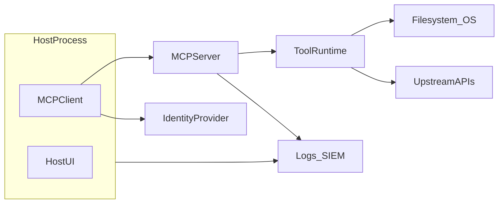

# 2. Introduction

## 2.1 What MCP is

The Model Context Protocol (MCP) is a structured way for **hosts** (such as desktop agents or IDE extensions) to connect **clients** to **MCP servers** that expose **tools**, **resources**, **prompts**, and related capabilities over a defined protocol. MCP separates “how the model talks to integrations” from any single vendor’s plugin format, which helps portability and interoperability.

In practice, an MCP deployment is a **chain of trust**: the host decides which servers to run, the client negotiates capabilities, the server routes model-driven requests to tools and data access paths, and upstream systems enforce their own policies.

## 2.2 Why MCP changes the security boundary

Traditional web and API testing often assumes a clear perimeter: a browser or mobile app calls an HTTP API with relatively stable entry points. MCP systems add:

- **Model-mediated control flow**, where natural language and partial context influence which tools run and with what arguments.
- **Tight coupling between data retrieval and action**, where the same channel can read a resource and trigger side effects through tools.
- **Distributed ownership**: the host, MCP server, tool runtimes, identity providers, gateways, and third-party APIs can be maintained by different teams with different threat models.

The security boundary is no longer only “HTTP ingress to a service.” It includes **local process boundaries**, **stdio or local sockets**, **remote transports**, **tool sandboxes**, **credential stores on the host**, and **human-in-the-loop approvals**—all of which can fail independently.

## 2.3 Why MCP security testing differs from traditional web/API testing

| Traditional web/API focus | MCP-specific additions |
|---------------------------|-------------------------|
| Parameter tampering on REST paths | Tool **schema** and **JSON-RPC** argument manipulation; dynamic tool lists |
| SSRF to internal URLs | Tool-mediated **egress** and gateway allowlists |
| Session cookies | Host-stored tokens, OAuth refresh, per-tool credentials |
| XSS in HTML | Unsafe rendering of tool outputs in host UIs; prompt and resource-driven injection |
| RBAC on APIs | **Model-routed** authorization: approval dialogs, tool chaining, planner loops |

Testing must combine **protocol review**, **local configuration review**, **runtime abuse cases**, and **agentic workflow** analysis.

## 2.4 Target audience

This guide is written for:

- **Developers** integrating MCP servers and tools.
- **Security testers and red teams** assessing MCP deployments.
- **AppSec and AI security reviewers** designing controls and gates.
- **Platform engineers** operating hosts, gateways, and fleet policy.
- **MCP server maintainers** responsible for tool safety and supply chain.

## 2.5 Scope

This guide covers security testing for:

- MCP **clients** and **hosts** (configuration, consent, rendering, logging).
- MCP **servers** (tool/resource handlers, authn/authz, transport exposure).
- **Tools**, **resources**, **prompts**, and related capability metadata.
- **Transports** (for example stdio, streamable HTTP) and channel security.
- **Registries**, packaging, and **supply chain** provenance.
- **Gateways** and enterprise policy enforcement.
- **Authorization**, **secrets**, **context** handling, and **agentic workflows**.
- **Logging**, **monitoring**, and detection validation.

## 2.6 Out of scope

- Legal advice, contractual interpretation, or regulatory attestation language (point to your compliance function).
- Model training security, fine-tuning data leakage, or GPU infrastructure—except where MCP context flows intersect (for example RAG resources).
- Denial-of-service against unrelated third parties; any destructive testing outside an authorized lab.

## 2.7 Safe testing rules and authorization requirements

1. **Written authorization** for every target environment (including internal staging). Verbal permission is not enough for formal assessments.
2. **Lab-first**: use synthetic workspaces, synthetic tools, and synthetic resources. Do not use customer production data as “test fixtures.”
3. **Non-destructive defaults**: prefer read-only probes, capped loops, and conservative rate limits. Escalate only with explicit approval.
4. **Data handling**: if you accidentally exfiltrate or log sensitive data during a test, follow your organization’s incident process; treat it as a real event.
5. **Rollback and recovery**: document how to restore configuration and revoke tokens after tests.
6. **Third parties**: do not aim abuse cases at vendors, registries, or shared SaaS without their engagement.
7. **Human safety**: tests involving approvals, elicitation, or user-visible actions must avoid misleading or harmful content.

## 2.8 Threat model primitives

When modeling threats, explicitly name these components and trust lines between them:

Use this diagram-level clarity to avoid “the model did it” as a substitute for **accountable control points** (host policy, server checks, gateway rules, IdP scopes).

## 2.9 How to use this repository

1. Read [03-mcp-security-testing-framework.md](03-mcp-security-testing-framework.md) for principles and methodology.
2. Use [04-mcp-security-testing.md](04-mcp-security-testing.md) to pick categories and test IDs.
3. Execute individual tests from the [`docs/tests/`](tests/) tree.
4. Document findings using [05-reporting.md](05-reporting.md) and [appendix-c-evidence-checklist.md](appendix-c-evidence-checklist.md).

## 2.10 Additional MCP risk surfaces (test planning)

Use this checklist when scoping work beyond “single tool, single call” reviews:

- **OAuth and delegated authorization:** redirect URI allowlists, refresh token storage, audience and scope binding, silent consent widening—exercise alongside `MCPSTG-AUTHN-*`, `MCPSTG-SECR-*`, and `MCPSTG-TRNS-02`.
- **SSRF and outbound tool traffic:** treat tool-mediated HTTP as **egress** subject to gateway allowlists (`MCPSTG-GW-*`), not only inbound MCP hardening.
- **Capability drift:** tools and resources that **register or change at runtime**, stale client caches, and version skew between host and server—map to inventory and regression tests (`MCPSTG-INFO-*`, `MCPSTG-SUPP-*`).
- **User interaction channels:** where MCP or host features use **elicitation**, forms, or sampling-style flows, treat prompts and user input as **trust boundaries** subject to `MCPSTG-PRMT-*` and approval UX tests (`MCPSTG-AUTHZ-*`).
- **Multi-tenant hosts:** shared developer machines, jump hosts, or pooled agents—validate session isolation and credential separation (`MCPSTG-AUTHZ-03`, `MCPSTG-CTX-04`, `MCPSTG-PRVC-*`).
- **Supply chain beyond package managers:** container base images, `npx`-style ephemeral installs, golden images, and signed provenance expectations (`MCPSTG-SUPP-*`, `MCPSTG-GOV-*`).

## 2.11 References (introductory)

- OWASP Web Security Testing Guide (structure inspiration only).
- OWASP LLM Top 10 for LLM Applications.
- OWASP API Security Top 10.
- OWASP Application Security Verification Standard (ASVS).
- Model Context Protocol documentation and specification (versioned).
